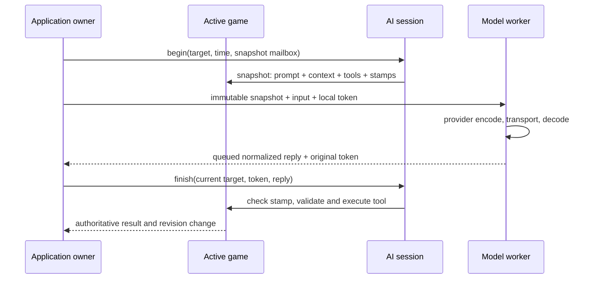

<p align="right"><a href="billiards-scorekeeper.zh_CN.md">简体中文</a> · <strong>English</strong></p>

# Billiards Scorekeeper

This branch starts a landscape game launcher, with Chinese eight-ball as its
first functional module, replacing the hardware-test startup with its own
320 x 240 UI. Original demo sources
remain as references but are not linked into the application. The 8 MB partition
layout is unchanged. Chase scoring, snooker, networking and AI speech are future
increments; they are not implemented in this checkpoint.

## Use and interaction contract

Two fixed players A/B count frames, with winner detection and undo of the last
32 operations. This is a match counter, not a ball tracker or referee. Player
names, ball groups, turn tracking and handicaps are not implemented.

| Screen | Short left / middle / right | Hold left / middle / right |
| --- | --- | --- |
| Scoreboard | A +1 / Settings / B +1 | A -1 / unassigned / B -1 |
| Settings | Previous / execute selection / Next | unassigned / Back / unassigned |
| Race setup | Decrease / Continue / Increase | unassigned / Back / unassigned |
| New-match confirmation | Cancel / Confirm / Back | unassigned / Back / unassigned |
| Global direction | Select 270 / Confirm / Select 90 | unassigned / Cancel / unassigned |

Board scoring applies immediately without selection or confirmation. Zero cannot
be decremented. Winning disables additions, but subtraction can correct a
mistaken winning point and reopen scoring. Game settings contains New Match and Undo. New-match clearing requires confirmation and is itself undoable.
Undo and match data survive restart.

Subpages consistently use middle short for execute/confirm and middle hold for
Back. Direction selection applies only after middle confirmation. Future modules
must preserve these meanings rather than moving confirmation to another key.
Double clicks are separate, currently unassigned events and do not act as short
clicks. Holds do not repeat. The BSP uses a 180 ms short-press window and a 500 ms
hold threshold; direct scoring still waits for gesture classification.

Default rotation is 270 degrees; Settings also offers 90 degrees, with the last
confirmed direction restored on restart. No portrait mode is exposed. The strip
follows the physical key edge: top at 270, bottom at 90. BSP hardware indices
UP/DOWN/OK map to visual left/middle/right at 270 and reverse at 90. All gestures
use this shared conversion. The user confirmed physical mapping on the device.
The separate hardware power button is not exposed as a software input and cannot
serve as a hint toggle with the documented wiring/BSP.

By default the display dims after 30 seconds and blanks after 120 seconds;
App Settings can change or disable either timer. The complete
wake gesture is consumed before scoring resumes. This saves backlight power;
it is not system sleep and does not establish battery runtime.

## Independent action registration and UI shell

`main/ui/app_actions.h` is a pure-C, allocation-free registry. Pages register
an action ID, label, enabled state, semantic role, visual slot and gesture.
`app_actions_resolve` dispatches from this same registry, so unregistered or
disabled actions cannot execute. Duplicate slot/gesture registrations are
rejected. Labels must outlive the registry.

```c
app_bindings_t bindings;
app_actions_clear(&bindings);
app_actions_register(&bindings, 0, APP_GESTURE_SHORT,
                     ACTION_PREVIOUS, "Previous", true, APP_ACTION_NAVIGATE);
app_actions_register(&bindings, 1, APP_GESTURE_SHORT,
                     ACTION_CONFIRM, "Confirm", true, APP_ACTION_CONFIRM);
uint16_t action = app_actions_resolve(&bindings, slot, gesture);
```

`app_shell` renders registered actions independently of the sport. It reserves
24 pixels per configured gesture group in short/hold/double order, omitting
empty groups. One/two/three rows leave 216/192/168 pixels of content height.
Symbols are `·` (short), `—` (hold), `··` (double). Empty cells show `--`; disabled
cells are muted. Eight-ball uses two rows for addition/subtraction. Modules draw
only inside `shell.content` and reflow to its height, without scattered button
instructions or undisplayed gestures.

Semantic backgrounds are shared across sports and gestures: green for confirm /
increase, orange-red for cancel / decrease, gray for Back, blue-gray for navigation
/ neutral actions. Labels and symbols remain alongside color. Modules register
roles, never page-specific raw colors.

## Configuration, architecture and extension

`score_config.h` / `.c` own sport defaults and bounds. Eight-ball is configured
for two players, default race to 10, range 1 through 35. Initialization, New Match
setup, controller limits, rule validation and displayed range read this config.
Existing records retain their target and score; changing defaults does not
migrate matches. Changing bounds requires a stored-record compatibility review.

- `score.h` / `score.c`: plain-C session, semantic commands, bounded snapshots,
  rule registry and versioned persistent codec.
- `chinese_eight.c`: validation, reducer and winner rule; accepts one-frame +1/-1
  adjustments and legacy frame-award commands, rejecting unsupported operations.
- `score_controller.c`: pages and action registration/dispatch.
- `score_ui.c`: game content widgets mounted inside the container-owned shell.
- `score_store.c`: backward-compatible NVS adapter.
- `games/eight_module.c`: eight-ball session owner, rule/controller adapter,
  initialization, command handling and persistence retries.
- `app/app_container.c`, `app_registry.c`: module registry, entry/exit and routing.
- `app/app_ui.c`: shared shell and single mounted content tree.
- `main.c`: hardware/input owner, battery snapshots, global backlight policy
  and LVGL synchronization.

Add a stable rule descriptor and configuration for another sport, with its
controller/presentation and tests. Signed points do not implement future rules;
ball/turn state may require a deliberate schema extension. BSP reusable hardware
logic remains separate from application state and screens.

Future voice must bind player and revision at recording start, validate and
deduplicate responses, then enqueue semantic commands to the same session owner.
`score_dispatch` rejects stale revisions and invalid operations and never calls
AI, networking, NVS or LVGL. Transport, authentication, timeouts and request
identity still need implementation.

## Persistence and failure behavior

Score changes write `billiards/session`: a fixed-width little-endian record with
version, CRC32 and undo history. The legacy direction blob is the versioned
`billiards/ui` record; global preferences now use `app_settings/config` as
described below and do not enter score history. Focus changes do not write
Flash. NVS commits run outside the LVGL lock; failed saves remain pending and
retry every five seconds, with visible failure status. Uncommitted changes may
be lost on power loss.

NVS initialization failures never trigger erase. Invalid score records are
preserved until confirming New Match permits replacement of this application's
record. Missing/invalid settings fall back to defaults; invalid records are
not replaced until the user confirms a setting. Other namespaces are not cleared.

## Fonts and verification

Fixed strings are inventoried in `score_strings.h` and `ui/app_strings.h`.
[Font provenance and regeneration](../../assets/README.md#scoreboard-font) cover
the licensed 16 px subset. Startup checks every required glyph against the actual
widget font and rejects placeholders. Arbitrary names/ASR output are unsupported.

The normal gate tests container navigation/lifecycle, mock isolation, module
re-entry and inactive save retries, plus rules, boundaries, winner correction, undo, stale commands,
configuration, old record restore, corruption, NVS failures, wake ordering,
physical-input conversion, semantic continuity and landscape BSP masks.

Actual LVGL host preview (requires LVGL 9.5.0 sources):

```bash
cmake -S tests/score_preview -B build/score-render -DSCORE_LVGL_SOURCE=/absolute/path/to/lvgl-9.5.0
cmake --build build/score-render -j 8
(cd build/score-render && ./preview)
```

It exports game pages, launcher and placeholders at both rotations, plus a
nine-action shell preview and one entry/scoring/exit path. It does not run
repetition/stress loops by default, as requested. It uses the device's 32 KB LVGL
pool; current key-screen previews observed a peak of 26048 bytes. Host rendering cannot prove physical
key placement, screen quality, timing or power consumption.

## Accepted stage checkpoint

2026-10-29: the user accepted the current interaction and visual design and
requested a local checkpoint commit. No push or release was requested.

- Build: PASS, complete gate with ESP-IDF 5.5.3.
- Host tests: PASS, including 500 stable LVGL renders.
- Device tests: PASS for application-write hash verification and 18-second boot
  observation; user accepted the revised UI and controls.
- Unverified: exhaustive page/glyph checks, power-loss/restart durability, all
  dim/blank/wake cases, long-run memory/stack margins and measured power/runtime.

Verified local archive:
`build/firmware/4c88c60ecf91f1057b88d72d8a0016e0c08c15127b5f5d6e50c6c51040454ea2/`.

- Full-image SHA-256: `4c88c60ecf91f1057b88d72d8a0016e0c08c15127b5f5d6e50c6c51040454ea2`
- Matching ELF SHA-256: `ab11160a7ccebdd9d1a8c5b6360c6d5091662f800c288659045bff8969a9e612`

Under the user's standing authorization to flash after successful builds, only
the matching 835920-byte application was written at `0x10000`, retaining the
compatible partition layout and NVS. Startup reached Ready with 215092 bytes free
heap and a 114688-byte largest block; no panic/assert/reset loop was observed.
The serial port was closed. Firmware, debug bundles and raw logs remain local
and ignored. A merged image at `0x0` may reset NVS; preserving state requires a
compatible segmented update, not whole-chip erase. This checkpoint commit does
not rebuild or reflash the accepted firmware.

## Launcher increment

Boot now always opens the game hall, with left Previous, middle Enter, right
Next. Select Eight-ball to resume the existing session. Chase, Snooker, App
Settings and AI/Voice are explicit UI-only placeholders; they can be entered
and exited but do not change data, provision networks or start services.
On the eight-ball board, middle hold returns to the hall. Existing subpage
middle-hold Back is retained; first return to the board to exit. Returning to the
hall and re-entering preserves score/history and pending saves.

`app_module.h` defines descriptors (stable ID/title/description/kind/context) and
callbacks: optional owner startup init, enter, leave, bindings, input, optional
tick, UI create and UI render. `app_registry.c` is the single module list;
`games/eight_module.c` supplies the real eight-ball descriptor. A future game
implements the callbacks and adds its descriptor to that list; it does not
modify `main.c` or the launcher renderer. A NULL ops pointer explicitly declares
a placeholder. Container-reserved action IDs are 65000 and above.

Owner callbacks run outside the LVGL lock and must not touch widgets. UI create /
render run inside it. Leave must stop all UI producers and return true before
the container destroys content; a failed leave keeps the game visible. There is
only one mounted content tree and one shell. Module tick runs even when the game
is inactive so failed saves are retried. Initialization loads legacy eight-ball
NVS once without rendering or starting a match. Neither menu browsing nor mocks
write match data.

The container owns current orientation, navigation and the application-level
entry points. In that initial increment, eight-ball reported direction changes as an effect to the
container; the existing UI preference blob/namespace remains unchanged. App
Settings was a mock in that initial increment; direction adjustment has since
moved to the global settings module described below. The AI/Voice entry and service kind establish navigation
placement only: no ASR/network service API or implementation is claimed here.
Global settings/service extraction can follow after this minimal container.

Host checks cover duplicate registration, failed entry/exit, nested Back vs Home,
placeholder isolation, inactive tick, eight-ball adapter re-entry and old saved
race restoration. Actual LVGL previews mount/unmount the real adapter once for
entry/scoring/exit and cover each important screen without stress loops.
No new commit or push is implied by this increment.

Validation on 2026-10-29:

- Build: PASS, complete gate with ESP-IDF 5.5.3 and verified debug archive.
- Host tests: PASS, including container/adapter logic and key-screen previews.
- Device tests: PASS for application-write hash verification and an 18-second
  startup observation only; physical interaction and appearance await user checks.
- Unverified: hall navigation, entry/return, score retention and both orientations
  on the physical device.

Verified local archive:
`build/firmware/7d9c7717ca4d6c05493e47eb9329f27df1d15fe151da3f4bf19b4bd35b5f8c3f/`.

- Full-image SHA-256: `7d9c7717ca4d6c05493e47eb9329f27df1d15fe151da3f4bf19b4bd35b5f8c3f`
- Matching ELF SHA-256: `ca0ebf3055aa3dee1f0ff13ea157c0a8538a235cf419190674d4c12353b34ef7`

The partition table matches the accepted checkpoint. Under the standing flash
authorization, only the verified 844000-byte application was written at
`0x10000`; NVS was not overwritten. Startup reached Ready with 214868 bytes free
heap and a 114688-byte largest block. No panic/assert/reset loop was observed,
and the serial port was closed.

## Illustrated carousel

The hall presents a horizontal carousel instead of list rows. Each registered
entry selects artwork through LVGL-independent `artwork` metadata. The center
card shows the image and title at full size; adjacent cards are smaller and
dimmer. Previous/Next uses a 220 ms eased slide with image/card scaling. The
existing three-button hints, semantic colors, wrap navigation and middle Enter
remain unchanged. Selection takes effect immediately, including Enter during
an animation. Fast reversals rebase the current offset without queuing effects.

`app_carousel` owns five reusable card widgets and one finite LVGL animation.
It cancels its animation before the container deletes content; idle cards have
no continuous animation. Pure geometry and wrap direction live in
`app_carousel_layout` and have focused host checks. Preview coverage includes
both rotations, an intermediate frame, a reversal, wrap, and leaving during a
transition; there are no repeated stress cycles.

Five original 176 x 96 RGB565 illustrations use 168960 bytes of Flash pixel
storage. They are read directly without a full-image decoder or new framebuffer.
The source generator and PNG previews are under the documented assets workflow.
The device still uses a 32 KB LVGL pool. Host previews establish layout and
callback safety only; animation smoothness and readability require the device.

Carousel validation, 2026-10-29:

- Build: PASS, complete ESP-IDF 5.5.3 gate; application 1014656 bytes.
- Host tests: PASS, focused geometry/routing tests and finite LVGL previews;
  observed peak pool usage 26048 bytes, final free pool 7944 bytes.
- Device tests: PASS for write-hash verification and 18-second startup only.
- Unverified: physical animation frame rate, appearance and rapid button switching.

Verified archive:
`build/firmware/d211c8dc88b47fcc2fe7284cbe8b783f60ab0a48159d2fb7617021a6c5dda874/`.
Full-image SHA-256: `d211c8dc88b47fcc2fe7284cbe8b783f60ab0a48159d2fb7617021a6c5dda874`.
Matching ELF SHA-256: `b54fae49a6925968ad56d8a29226440cc2e705ebba79041e8c77bd3029c2d579`.
Only the verified application was written at `0x10000`, with the unchanged
partition table and no NVS overwrite. Startup reached Ready, free heap 214772
bytes, largest block 114688 bytes, with no observed panic/assert/reset loop.
Serial observation ended and the port was closed. No commit or push was made.

The user accepted the carousel appearance and functionality on 2026-10-29 and
requested a local checkpoint commit. No push or release was requested.


## Global settings and shared ranges

App Settings is now functional: direction, brightness, auto-dim, auto-blank and
device information. Eight-ball retains only New Match and Undo. Direction is
confirmed in the global module and propagated to the container; 270/90 key
mapping and hint placement remain shared. Left/right browse settings, middle
short press edits/confirms, middle hold cancels editing or returns to the hall
when browsing. Device information shows firmware version and SOC/mV snapshots
refreshed by the owner every 30 seconds; this does not calibrate the gauge.

The shared `ui/app_range` widget displays the current value above a rail and
handle, with minimum/maximum labels below the ends. Brightness uses 20..100%
in steps of 10. Dim timeout stops are 15/30/60/120 seconds/unlimited; blank
stops are 60/120/300/600 seconds/unlimited. Unlimited is the far-right stop
and disables that timer. Ends clamp rather than wrap. A disabled dim timer does
not disable blanking, or vice versa; blanking takes priority when both expire.
Brightness previews immediately, but Cancel restores the confirmed value.
New-match race selection also uses the shared rail with its configured bounds.
It creates that widget only while its page is visible to fit the 32 KB pool.

`app_preferences` owns defaults, validation, codec and idle policy;
`app_settings_model` owns button editing independently of ESP-IDF/LVGL.
The real settings module owns persistence and UI. Confirmed preferences use
`app_settings/config`: 16-byte AP/version-1 blob, direction code, brightness,
little-endian dim/blank seconds (zero disables), reserved bytes and XOR check.
With no new record, the legacy `billiards/ui` direction is read and migrated
with default brightness/timeouts. The old direction record and match blob are
not overwritten. Malformed/unreadable records use defaults and show an error;
only explicit confirmation replaces them. Save failures retry at five-second
intervals, even after returning to the hall. No browsing/preview writes occur.

Host checks cover codec corruption, timeout boundaries, bounded adjustments,
cancel/confirm, legacy migration and NVS read/write/commit failures. Finite
LVGL previews cover range endpoints, infinity, both orientations, device info,
confirmed direction propagation and cancellation. No stress loop is used.
Wi-Fi provisioning was deferred at this checkpoint; it is implemented below.
AI/voice and hardware sleep remain deferred.


Settings build verification, 2026-10-29: Build PASS (complete ESP-IDF 5.5.3 gate),
Host tests PASS and finite key-screen previews PASS; peak LVGL pool 25440 bytes,
final free pool 7800 bytes. Verified application size 1033904 bytes.
Archive: `build/firmware/6e5d6e239cef9b0d4f7039e179c37f02b4d01da71c3764cbf757aff4af9e595e/`.
Full-image SHA-256: `6e5d6e239cef9b0d4f7039e179c37f02b4d01da71c3764cbf757aff4af9e595e`.
Matching ELF SHA-256: `b4dfbdfef855138d234651b5f59f6dd755e64b71307c3ebbf08945b61333790f`.
Under the standing authorization, only the verified application was written at
`0x10000`, retaining the compatible partition table and existing NVS contents.
Physical slider operation, brightness preview/cancel, timeout/wake and restart
persistence remain user/device acceptance checks. No new commit or push.

Device tests: PASS for write-hash verification and 18-second startup only.
Ready reported 214516 bytes free heap and largest block 114688 bytes; no
panic/assert/reset loop was observed. Serial closed. Physical checks above
remain unverified.

## Standalone QWERTY input laboratory

The Input Test entry is removed from the production hall. Its standalone lab is
retained only as a host preview fixture and is excluded from the firmware build.
The reusable input component remains available to Wi-Fi setup.
The previous frequency-based grouping and group-selection screens are discarded.
This iteration implements a phone-style QWERTY 26-key keyboard, with separate
number and symbol modes. Nine-key composition is deferred; it is not exposed as
an implemented option. Tasks remain `there`, `1234567890`, `Ther_2026!`, and free
input. Results show entered text and target match only; no statistics appear.

| Gesture | Left key | Middle key | Right key |
| --- | --- | --- | --- |
| Short | Move left | Insert/select/confirm | Move right |
| Long | Previous row | Backspace | Next row |
| Double | Toggle case (ABC from number/symbol mode) | Edit menu | Cycle ABC/numbers/symbols |

The footer provides visible ABC/123/symbol, Space, Menu and Finish keys. Users
can select every operation without shortcut knowledge. Numeric-only mode hides
non-digit insertion and keyboard switching. Every available gesture registers
its current label and semantic role with the shared hint bar. Horizontal movement
wraps inside the row; vertical movement wraps between rows and maps by relative
column center. Long press moves exactly once, with no auto-repeat. Cursor mode
uses left/right, middle to return, and middle long to backspace. The edit menu
offers cursor, reveal/hide, confirmed clear, finish and confirmed exit. Confirmation
keeps middle as Confirm, left as Cancel and right as Back.

`input/text_input` owns an allocation-free ASCII editor and data-defined keyboard
rows, independent of ESP-IDF/LVGL. It accepts maximum length (up to 64), numeric
restriction, secret mode and initial text. The lab uses 63 characters and visible
text. All printable ASCII, including space and uppercase, is reachable. Secret
mode reveals only the last inserted character for one second; a separate expiry
refresh masks it without relying on statistics or later keypresses. Exit wipes
text, and nothing is persisted or transmitted.

`text_input_ui` uses the verified 14 px Chinese/ASCII font, compact input line and
four keyboard rows. It renders keys through one LVGL draw callback rather than
allocating one widget per key. The UI takes a model snapshot under the existing
LVGL lock; drawing does not read the editor while the owner task changes it.
Row layout is reusable for future keyboard work; nine-key character selection
and any prediction require a separate implementation. No Chinese composition
is claimed. Button callbacks still only enqueue events, and there are no UI
workers/timers to stop at exit.

Host checks cover ASCII inventory, all-key reachability, row wrapping/mapping,
all nine gesture bindings, footer actions, case/mode isolation, insertion,
backspace/cursor, masking, length limits and confirmed clear/exit. Finite LVGL
previews cover both rotations, case, all modes, menu, cursor, clear, exit and
results. No stress loops run. The user accepted this QWERTY design; exhaustive physical
key acceptance and comparative input efficiency remain unverified.

Validation, 2026-10-29: Build PASS and Host tests PASS through the complete gate.
Finite LVGL previews PASS: peak pool 25440 bytes, final free 10488 bytes. The
application is 1072064 bytes.
Archive: `build/firmware/226e6024ffb6736cc17a6a0a5910b51db1713969c0d041b9d8c7bc9b8363918b/`.
Full-image SHA-256: `226e6024ffb6736cc17a6a0a5910b51db1713969c0d041b9d8c7bc9b8363918b`.
Matching ELF SHA-256: `942c152f07802f42c227168509488589c7b8ac97a84de727a0c771c409015bd9`.
Device tests: PASS for application-only write hash and 12-second matching-ELF
startup, without observed panic/assert/reset loops. Settings/NVS and partition
table were not overwritten; serial closed.
Unverified: exhaustive physical key operation, gesture timing and practical
input efficiency. The user accepted this version.

## Hotspot provisioning and phone settings

Open App Settings, select Network Connection, then enter the network page and
press the middle key to enable the setup hotspot. The device displays a
`Billiards-xxxx` open SSID (no hotspot password) and
`http://192.168.4.1/`. Connect the phone to that hotspot and retain the connection
when it reports no Internet access. DNS/HTTP captive redirects assist automatic
opening; manually enter the URL when the phone does not open a page. Automatic
opening depends on the phone and is not guaranteed. No BLE or mini program is
required. The hotspot expires after five minutes or can be closed on the device.

The local page accepts a manually entered 2.4 GHz Wi-Fi SSID/password and also
provides direction, brightness, dim and blank settings using the same bounded
ranges as the device. A nearby-network selector is now provided as described below.
Changes apply through the existing settings owner and persistence retry path.
A successful HTTP submission acknowledges receipt, not durable saving. The page
shows connection state, IP and device errors. A successful station association
and DHCP address are required before saving credentials; a wrong
password leaves all saved network records untouched. Up to three delayed
retries use 2/4/6-second intervals; individual attempts time out after 20 seconds.
Up to 10 SSID/password pairs are retained in an insertion-order ring. An existing
SSID updates its password in place; a new SSID overwrites the oldest insertion
only when all 10 slots are occupied. Failed writes do not publish the replacement
in RAM. Boot and Retry use the last successfully saved connection. Both the
device and phone provide a saved-network selector without returning passwords.
The existing single-network record is imported when no history exists. Confirmed
Clear Saved Networks writes an explicit empty history so imported data cannot
reappear. Unchanged reconnects avoid redundant writes.

`main/network` isolates form/credential/DNS/timing policy from the Wi-Fi worker.
Button handlers enqueue requests. Wi-Fi events enqueue bounded records; only
the service worker handles networking and its NVS namespace. HTTP queues display
changes for the application owner; it never accesses LVGL or settings storage.
Management requests require a connection addressed to the setup AP interface;
API requests also check the canonical host, and writes require a per-session
token. The HTTP page is local; the setup hotspot is open and its radio link is
not encrypted. NVS credentials are not encrypted at rest. Passwords are never logged. No Internet reachability,
cloud API, AI/voice transport or permanent LAN management service is claimed.
The network service lasts for the application lifetime and stores no UI pointers.
Wi-Fi buffers and HTTP connections are bounded for this no-PSRAM board.

The captive DNS/HTTP approach follows the ESP-IDF 5.5.3
[captive portal example](https://github.com/espressif/esp-idf/tree/v5.5.3/examples/protocols/http_server/captive_portal).
The settings page and device UI are application-specific implementations.
Focused host checks cover strict decoding, credential limits, shared setting
validation, malformed DNS packets, retry limits and timeout boundaries. Finite
LVGL previews cover the offline, hotspot and Forget screens in both rotations.
A mobile-width browser preview uses synthetic responses, not a physical radio.
Actual phone captive opening, successful/wrong-password provisioning, reconnect,
Forget, expiration, remote settings persistence and RF/memory behavior require
on-device acceptance. Build identity and observed device results follow below.

Validation, 2026-10-29: Build PASS and Host tests PASS through the complete gate.
Finite LVGL previews PASS (peak pool 25440 bytes, final free 10464 bytes).
A 390-pixel browser preview verified no horizontal overflow, Wi-Fi submission,
90-degree selection and unlimited dim submission against synthetic responses.
Application size: 1711552 bytes.
Archive: `build/firmware/17a3c5c6f7e3c16ecb57453319fa756cf3bd846a5f18517569597e864e8b77bf/`.
Full-image SHA-256: `17a3c5c6f7e3c16ecb57453319fa756cf3bd846a5f18517569597e864e8b77bf`.
Matching ELF SHA-256: `0ca4ad14e6e903aa67cf220bbe58e7b3e95231b14bc4c38f6abee4d7607c19df`.
Device tests: PASS for application-only write hash and 12-second startup only.
Both application and network service reached Ready, with 120936 bytes free heap
and a 110592-byte largest block; no panic/assert/reset loop was observed.
Only `0x10000` application data was written; partition table and NVS were not
reflashed. The serial port was closed. Physical phone/network acceptance above
remains Unverified. No commit or push was made.

Open-hotspot correction, 2026-10-29: the setup AP now uses `WIFI_AUTH_OPEN`,
with no generated password or password input when joining. The device displays
an explicit password-free connection hint. The station Wi-Fi password field
on the phone page remains necessary for a protected upstream network.
Build PASS and Host tests PASS through the complete gate; finite LVGL previews
PASS with verified font coverage. Archive:
`build/firmware/c7f34acf321dbe965ad25777531b9c767cf01c43a208033b8565ff565962999d/`.
Full-image SHA-256: `c7f34acf321dbe965ad25777531b9c767cf01c43a208033b8565ff565962999d`.
Matching ELF SHA-256: `32afe03d033d4ab08bce792f444497ff02bf8e256433599f3fed287e7fb65b38`.
Only the 1711680-byte application was flashed at `0x10000`, preserving NVS and
the partition table. Device tests PASS for write verification and 12-second
startup only: application/network Ready, free heap 120784, largest block 110592,
no observed panic/assert/reset loop; serial closed. Phone joining and captive
opening remain Unverified. No commit or push.

Hotspot page access correction: ESP-IDF enables dual-stack HTTP sockets when
IPv6 is configured. lwIP then reports an IPv4 destination as an IPv4-mapped
IPv6 sockaddr. The original IPv4-sized address buffer truncated this structure
and incorrectly returned HTTP 403 for a phone visiting the setup AP. The source
check now reads sockaddr_storage and recognizes both IPv4 and exact mapped
IPv6 forms of 192.168.4.1; other LAN/native IPv6 addresses remain rejected.
Finite host regression checks cover both accepted forms, truncated structures,
non-AP IPv4/mapped addresses and native IPv6. Physical page access must be
rechecked after updating; browser mock acceptance did not cover this socket path.

Socket fix validation: Build PASS, Host tests PASS (complete gate). Archive:
`build/firmware/f0efeb68a1c4f5d7f2aeaad3d758278288e0497aed54b0c9e616d3fca0a0279b/`.
Full-image SHA-256: `f0efeb68a1c4f5d7f2aeaad3d758278288e0497aed54b0c9e616d3fca0a0279b`.
Matching ELF SHA-256: `8b80353a1e1ae81aba6676ea534a3733e2fb831e9044022c3c5e7adde211d12d`.
The verified 1711840-byte application was flashed at `0x10000` only; NVS and
partition table retained. Device tests PASS for flash hash and 12-second startup
only; both services reached Ready with no observed panic/assert/reset loop.
Serial closed. Actual phone HTTP access remains Unverified pending user retest.

## Nearby Wi-Fi selection

The phone page requests one asynchronous scan on opening and offers Rescan.
The selector lists up to 16 strongest visible networks, with signal strength and
open/protected labels. Equal SSID/security pairs merge using their strongest
RSSI. Choosing an entry fills the SSID field and clears any previous password;
manual input remains available for hidden networks. Network names are rendered
as text, and JSON encoding escapes special characters. Selecting does not connect
until the user submits the Wi-Fi form.

The existing worker owns asynchronous scan start/completion, a 15-second deadline
and driver-result cleanup. Connection/retry or closing the hotspot cancels a
scan and releases its result list. Scanning is rejected during connection; the
page allows retry or manual entry. GET `/api/networks` returns the bounded cached
list; POST `/api/scan` requires the same AP-origin/session checks as other writes.
No network names or passwords are logged. Tests cover empty/unterminated names,
strongest-signal deduplication, sorting, capacity and UTF-8 names. Browser checks
use synthetic scan responses; physical discovery and AP continuity remain
separate device acceptance checks.

Scan increment validation, 2026-10-29: Build PASS and Host tests PASS through the
complete gate. Mobile-width browser checks PASS with synthetic responses:
network listing, selection with Chinese/quotes/angle brackets, SSID fill,
password focus, rescan and no horizontal overflow.
Archive: `build/firmware/9fce16d6350d9e1a1ffb9627778093e42ea89b96a59fa1ea33a398a22a7a3442/`.
Full-image SHA-256: `9fce16d6350d9e1a1ffb9627778093e42ea89b96a59fa1ea33a398a22a7a3442`.
Matching ELF SHA-256: `76bf2ab3033d337c0cab5d74f90576a73298f0a5c3d0154e6f701b11b15a3af5`.
Only the 1742720-byte application was flashed at `0x10000`; NVS and partition
table retained. Device tests PASS for flash verification and 12-second startup
only: application/network Ready, 120076 bytes free heap, largest block 110592,
no observed panic/assert/reset loop. Serial closed. Unverified: real RF list,
scan/connection cancellation and phone hotspot continuity. No commit or push.
The user confirmed the prior socket fix displays the phone settings page.

## Connection progress and result feedback

The phone now shows a dedicated live result panel next to the Wi-Fi form and
polls once per second, with one in-flight status request and a five-second
request timeout. Submission scrolls to the panel and shows Connecting immediately.
Connecting shows the attempt (one initial plus up to three retries), remaining
time and DHCP phase. Success displays the escaped SSID, IP and whether the network
was saved. Failure shows an actionable reason category and allows resubmission.
Authentication errors suggest checking credentials/router settings rather than
claiming the password is certainly wrong. Temporary phone disconnection during
an AP channel change displays Waiting for device result, not a false failure.
The server provides JSON-escaped SSIDs and a separate network-save error.

The device network page promotes connection state to its main heading: neutral
progress, green Success, orange Failure, with IP/save result or a short failure
hint in the content area even while its setup hotspot remains active. It retains
the hotspot name, URL and countdown. The 14 px application font keeps content
inside both landscape layouts. Arbitrary SSIDs remain on the phone page because
the fixed device font cannot represent every possible network name. Connection
progress and a result transition reset idle blanking so the screen stays visible.
Obtaining an IP establishes router connectivity, not Internet/cloud reachability.

Before this correction, a bounded serial read observed Station obtained IP
without a crash; the existing result was too inconspicuous and the phone's
submission message never changed into a final result. This is not a claim of
end-to-end acceptance of the new version. Finite previews now cover Connecting,
DHCP, Success, save failure and authentication failure in both rotations.
Host checks cover reason categorization, while browser response simulation
checks the actual submitted-to-success/error UI transitions.

Feedback validation, 2026-10-29: Build PASS and Host tests PASS through the complete
gate. Finite LVGL preview peak 25440 bytes, final free 10432 bytes. Mobile browser
simulation verified actual form submission reaches green Success with IP/save
confirmation, and injected authentication failure shows a retryable reason;
390-pixel layout had no horizontal overflow.
Archive: `build/firmware/2fece9ef594bf8e5bb0d867d95e3e20736b6d268d4c32219d0eb1508eb317527/`.
Full-image SHA-256: `2fece9ef594bf8e5bb0d867d95e3e20736b6d268d4c32219d0eb1508eb317527`.
Matching ELF SHA-256: `663797803abaf49b5d10e0bc0f51aa7390ce5783f1f80dc963827421b8e867fb`.
Only the verified 1750112-byte application was flashed at `0x10000`, retaining NVS
and partition table. Device tests PASS for write hash, 15-second startup and
saved-network reconnect obtaining an IP at about 3.1 seconds. Network-ready heap
117884 bytes, largest block 106496 bytes; connected heap 116964 bytes. No observed
panic/assert/reset loop; serial closed. Unverified: physical new status appearance,
phone polling on real hotspot, wrong-password recovery and real save failures.
No commit or push.

## Shared header and device-side Wi-Fi setup

The hall no longer shows a title. A single `ui/app_header` overlay owns the
module label at the left, current setting/page centered in a contrasting 28 px
bar, and network/battery status at the right. The hall retains only those status
indicators with a transparent background. Game, settings, input and placeholder
pages use the same header; modules supply context text instead of duplicating
battery/title widgets. The three-bar network symbol is green when connected,
yellow while connecting, blue for setup hotspot only, grey when offline, and
adds an orange exclamation mark on failure. It indicates state, not measured RSSI.
The main owner refreshes the header when the network snapshot changes.

Direction presents both 270-degree/buttons-above and 90-degree/buttons-below
options as visible rows, with the selected row highlighted. Middle opens editing,
left/right changes selection, middle confirms and middle hold cancels. Device
information includes connection state and IP. The network settings summary
shows state, current SSID and IP.

Entering Network opens an operation list: Select Wi-Fi, Phone hotspot setup,
Reconnect and Forget. Left/right browse, middle enters/confirms, middle hold
returns; confirmations preserve left Cancel, middle Confirm, right Back.
Select Wi-Fi starts a worker scan even with the hotspot disabled. The list
shows networks plus Manual name and Rescan. Protected networks open the existing
QWERTY component in masked mode; open networks go directly to confirmation.
Manual ASCII SSID entry opens the same component before the password editor.
Scanned UTF-8 SSIDs retain their original bytes, regardless of display fallback.
Password validation shares the phone protocol limits. Confirm queues a connection
through the same worker and success-only credential persistence path. Cancel,
leave and successful submission clear temporary secrets. The component does not
log input or add its own Wi-Fi task. Application/UI callbacks remain nonblocking.

`network_setup` is an IDF/LVGL-independent workflow with focused host checks for
scan selection, protected/open paths, manual entry, invalid credentials, cancel,
confirmation semantics and disposal. Its UI mounts either a short list or the
keyboard, never both, to fit the existing 32 KB LVGL pool. The host-only lab
uses unchanged gestures. `network_font_14` adds Flash-resident
2 bpp ASCII/CJK network-name coverage; unsupported characters display as `?`
without altering submitted SSIDs. See the paired assets documentation for
source/license and reproducible generation. Physical key timing, readability,
new-credential connection and RF continuity still require device acceptance.

Shared-header/device-setup validation, 2026-10-29: Build PASS and Host tests PASS
through the complete gate. Finite real-LVGL previews cover hall, all settings,
network menu/list/keyboard, open-network confirmation, Forget and both rotations;
peak pool 24728 bytes, final free 10928 bytes. The test adapter uses synthetic
networks; no stress loop is run.
Archive: `build/firmware/aed9dec557106934696da79f240f11d8ea774e451ed02cdacde6dc1009a83ff5/`.
Full-image SHA-256: `aed9dec557106934696da79f240f11d8ea774e451ed02cdacde6dc1009a83ff5`.
Matching ELF SHA-256: `f0ae8886efc07996edbf3a82efe9bf88b5d3087c063dc06925bf11374ef7703a`.
The verified 2927600-byte application alone was flashed at `0x10000`, preserving
NVS and partition table. Device tests PASS for write hash, 15-second startup and
saved Wi-Fi reconnect obtaining an IP at about 3.3 seconds. Network-ready free
heap 116348 bytes, largest block 106496; connected free heap 115404, largest
102400. No panic/assert/reset loop observed; serial closed. Unverified: physical
header/SSID readability, device-side scan/password/confirm flow, actual cancel
and new-network connection, and coexistence with phone provisioning. No commit
or push was made.

Network-summary layout correction, 2026-10-29: status, Wi-Fi name and IP now use
three independent rows, replacing blank-line positioning that overlapped the
SSID and IP. Network names use the normal text color and long names use a
single-line trailing ellipsis. Finite LVGL previews cover offline, connected,
32-byte names, navigation to/from device information and both real rotations;
peak pool 24728 bytes. Build and Host tests PASS through the complete gate.
Verified archive: `build/firmware/f4b953422b1c1be6aecbc490f5e1528f69927686fd78809803a4414c7303a8f8/`.
Full-image SHA-256: `f4b953422b1c1be6aecbc490f5e1528f69927686fd78809803a4414c7303a8f8`.
Matching ELF SHA-256: `b999c108c05ee26d46d597ff4a53fd99de832c3d3842d7dbe115f1b493c01a78`.
Device tests PASS for application-only write/hash at `0x10000`, 15-second
startup and saved-network reconnect obtaining an IP at about 3.4 seconds;
NVS and partition table preserved, serial closed. No panic/assert/reset loop
observed. Physical readability remains Unverified. No commit or push.

Input-entry removal validation, 2026-10-29: Build and Host tests PASS through
the complete gate. Finite LVGL previews assert five production entries, exclude
the lab and retain the Wi-Fi keyboard. Device tests PASS for application-only
write/hash, 12-second startup and saved-network reconnect; NVS preserved.
Archive/full-image SHA-256: `build/firmware/3d1e361f386dd3a1baafb2207b1b5528d043c385189f710458c59ed48a69c2e8/`.
Matching ELF SHA-256: `f6bfefb62c7d3c575eb09a0defdc13ac543279a5818888a71d51fe5d7e568758`.
Unverified: physical hall navigation. Serial closed; no commit or push.

## Independent offline speech proof of concept

The AI / Voice entry now opens a dedicated listening page. Left short press
cycles three sample sentences, middle short press requests playback, right
short press stops, and middle hold returns home and cancels playback. It never
speaks automatically on boot or entry. Volume is fixed at 65 percent for this
proof of concept. Game scoring does not yet submit speech events.

`main/speech/app_speech` is an app-lifetime service independent of pages and
LVGL. Call `app_speech_say()` with bounded UTF-8 text; it copies the request
without blocking. A 650 ms quiet interval merges consecutive pending requests.
An active sentence finishes before the latest pending sentence starts; requests
never accumulate into an unbounded queue. Stop invalidates the pending request
and cancels active playback at a PCM boundary. The worker alone owns synthesis,
codec format and playback after startup, and never accesses UI objects. Its
snapshot reports waiting, playing, completed, stopping and errors. Leaving the
page cancels work without freeing service-owned data. No recognition or cloud
service is included. Future games can call the same interface.

`main/speech/speech_model` is platform-independent and tested for merge timing,
latest-only replacement, cancel, UTF-8 validity and text bounds (120 bytes).
The worker uses an 8 KB stack, 16 kHz / 16-bit mono streaming, 320-sample writes,
conservative heap admission and lazy per-utterance TTS allocation/cleanup. Codec
sleep is restored after playback. I2S IRAM-safe interrupts are enabled, but
concurrent Flash/NVS stall immunity is not assumed. The pinned C3-only official
TTS subset and its license are documented in
[the component provenance](../../components/esp_tts/README.md). The 2913777-byte
Xiaoxin small voice is Flash-mapped inside the factory app; the existing NVS,
PHY and application partition layout is unchanged. Actual audibility, quality,
stop latency, memory during synthesis and concurrent network use require board
acceptance. A successful build or preview cannot establish those results.

Offline speech validation, 2026-10-29: complete gate Build PASS and Host tests
PASS. Finite real-LVGL previews cover both orientations, request, playing,
stop, error and leave using a synthetic audio adapter (peak pool 24728 bytes).
Archive/full-image SHA-256:
`build/firmware/3b7de608bb27b093810462eac25ea53a36d274f2bbbe589cf53ff3fcce93f1ba/`.
Matching ELF SHA-256: `78e517455f4306400e5795246785fc2bab5279059e009f45e414852c29602362`.
The 5941840-byte app was flashed at `0x10000`, with unchanged partition table
and preserved NVS. Device tests PASS for write/hash, 15-second startup and
saved-network reconnect at about 3.7 seconds, with no panic/assert/reset loop.
Connected free heap 99348 bytes, largest block 90112. Serial is closed. No TTS
request was triggered during this startup check: actual synthesis, peak memory,
stack margin, audible output and physical stop/merge remain Unverified and are
handed to the user via the AI / Voice page. No commit or push.

Speech wake correction, 2026-10-29: user playback returned decimal 259
(`ESP_ERR_INVALID_STATE`). Startup and post-playback suspend the codec; calling
`bsp_audio_set_format()` while suspended is rejected. The speech worker now
initializes idempotently and calls `bsp_audio_wake()` before setting the format.
A stateful codec regression reproduces failure with the old playback code and
passes initial playback, replay after suspend, wake failure propagation and
recovery with the fix. This host check does not validate real TTS output.

Wake-fix complete gate: Build PASS, Host tests PASS. Verified archive/full-image
SHA-256: `build/firmware/99a0876703ba35c1709b010c93fc6f595b84fed612d9420c5bae3f6389795195/`.
Matching ELF SHA-256: `dafc100aa7c60b705c831fc6408bb79b9ef54ac80c257b371ede53ced485c9f1`.
Device tests NOT RUN: the target USB port is unavailable; no firmware written.
Unverified: actual TTS playback and replay on the board.

Wake-fix device handoff, 2026-10-29: after the user reconnected the target,
the verified 5942192-byte application from the above `99a087...` archive was
flashed at `0x10000` with hash verification, preserving NVS and partitions.
Device tests PASS for write/hash, matching ELF `dafc100aa...`, 15-second startup
and saved-network reconnect at about 3.7 seconds; no panic/assert/reset loop.
Connected free heap 99384 bytes, largest block 90112. Serial closed. Actual
playback/replay remains Unverified pending user-triggered listening.

## Unified model configuration

AI / Voice opens a list containing hotspot setup, saved named models and offline
listening. The hotspot entry works even with no saved model. Up to four profiles
can be stored; left/right scroll the list and middle opens the focused entry.
From model details, right activates that model. Left/right choose and middle opens; middle hold returns one level.
There are no provider presets, account links, platform placeholders or separate
ASR credentials. Model settings remain separate from general application settings.

The phone form selects a profile or an empty slot and accepts a custom name
(up to 12 supported characters / 36 UTF-8 bytes), the service's Model ID (up to 96 printable ASCII bytes),
full API URL (up to 256 bytes) and API Key (up to 256 bytes). Model identifiers may
contain slashes and colons. The URL must include the complete request path;
HTTP(S) is supported without redirects, query strings or URL credentials.
HTTPS uses the ESP-IDF root certificate bundle. HTTP sends credentials and audio
in clear text. Saving activates the model; a blank Key retains the saved Key.
Deleting a model clears that entire slot and disables it if active. Other profiles
remain intact. Names support printable ASCII, CJK U+4E00..U+9FEF and common CJK
punctuation using the existing network font; emoji and unsupported scripts are
rejected. Each profile keeps its own Key; a blank Key only retains that slot's Key.
Keys are never returned in snapshots, UI or HTTP responses.

From the AI / Voice list, hotspot setup directly opens phone provisioning.
From a device model page, left also opens phone setup, middle starts detection and
right activates a saved inactive configuration. The first QR joins the temporary
password-free hotspot; middle switches to `http://192.168.4.1/#ai`.
The device shows the same saved Model ID, full scrolling URL, capability stages
and error vocabulary as the phone portal. Polling preserves unsaved phone edits;
if another client changes configuration, the form requires an explicit reload.

`main/ai/ai_config` validates the form and implements pure save/select/remove
transitions. `ai_config_store` serializes one bounded request through the network
worker, outside button/LVGL callbacks. New settings use `ai_voice/profiles`: `AI`, version 1, active byte, then four
fixed name/Key/Model ID/URL byte arrays of 37/257/97/257 bytes per profile.
The network worker allocates bounded serialization scratch only during reads
and writes, then clears and frees it. Voice/probe code reads a small runtime
snapshot rather than retaining the full public configuration list. The portal selects slots explicitly and both UIs display the same
profile names, fields, current selection and per-profile detection results. Old model records are ignored, with no migration or compatibility
branches. Users must re-enter AI settings; Wi-Fi, match records and player names
are unaffected. Failed writes/commits retain the active configuration. The phone
waits for durable completion before reporting success.

### Protocol and capability detection

The single adapter implements non-streaming Chat Completions with bearer
Authorization. The URL is supplied by the user, without provider-specific request
parameters. Voice control additionally requires Base64 WAV `input_audio` and
function tool calls in the same request. A model supporting text alone, a different
audio envelope or only a Realtime API is insufficient for this path.

Saving on the phone automatically requests detection; either UI can rerun it.
`ai_probe` runs three isolated checks: an exact text response, a function call with
known arguments, then a fixed synthetic recording identified through a tool call.
Each successful stage is recorded; failure stops the sequence and preserves prior
results and an error reason. Detection has a total 60-second budget, shares the
voice worker so microphone requests cannot run concurrently, and never accesses
the live game's executor. It uploads no microphone recording and changes no score.
There are up to three small API requests, which may incur service charges.
A pass verifies this sample only, not universal recognition or model compatibility.

Editing or deleting a profile invalidates its detection result; selecting another
profile preserves completed results. A global generation counter invalidates any
in-flight game/probe request when settings change. Only one probe runs at a time.
Ordinary status polling does not invalidate game sessions.
Detection results are RAM-only and reset after reboot. Both UIs distinguish queued,
text/tools/audio checking, pass, failure and stale states, including authorization,
URL/model, rate-limit, network, memory, timeout and invalid-response reasons.

Host checks cover validation, durable save/restart failures, capability state
invalidation, generic request encoding, shared transport, and isolated detection
success/partial failure/wrong audio. Browser checks use simulated HTTP responses;
LVGL previews exercise both landscape rotations. Real-hotspot persistence,
board RAM/stack peaks, actual model compatibility and audio comprehension still
require device acceptance with the user's configured service.

Validation, 2026-10-30: complete gate Build PASS and Host tests PASS; focused
voice/probe tests also passed AddressSanitizer and UndefinedBehaviorSanitizer.
Browser checks used a simulated API at desktop and 390 px widths, covering
save/automatic detection, identifiers containing slash/colon, invalid URL rejection,
draft preservation and reload confirmation. Both landscape LVGL previews passed
with a 24792-byte peak in the 32 KB pool.
Verified archive/full SHA-256:
`build/firmware/51df873d40bf4ca6913b3e3ab8bff683479e834ddb6464796abfe4f5fd3710ad/`.
Matching ELF SHA-256:
`9ec0584c75da4213b9e578ce70f8e350c340898e12199ec9bb1ec5c900f919cd`.
The connected ESP32-C3 partition table matched. Segmented bootloader/table/app
flashing and hash verification passed, preserving NVS regions. The bounded
15-second serial window captured no bytes, so startup is unverified. Device tests
PASS applies only to writing/hash verification; screen/buttons, real-hotspot
save/restart, actual model calls and RAM/stack peaks remain unverified.

Named profiles validation, 2026-10-30: complete gate Build PASS / Host tests PASS.
Focused voice/probe ASan/UBSan tests passed. Tests cover separate keys, restart,
switch/remove behavior, stale in-flight probes, and routing voice to a nonzero
profile slot. Simulated-API browser checks cover two named profiles, automatic
checks, current-model selection, removal isolation and 390 px layout. Real-LVGL
previews cover the direct hotspot entry, multi-model list and selecting the second
model in both rotations (24792-byte peak). Actual RF provisioning, persistence,
model calls, audio and board memory peaks still require device acceptance.
Verified archive/full SHA-256: `build/firmware/ccc5bbe3f33d2a8f567501c0d0c1e7b87c82971f54bb5e415e17070dcbcfc377/`.
Matching ELF SHA-256: `4dc0e7542f250909b8aedebb7193e3a9d90bfcf832819e8c113fa6507f3d1ac0`.

The matching device partition table was checked. Segmented flashing and Flash
hash verification passed while preserving NVS. A 12-second startup capture was
empty; boot, screen, buttons and live model checks remain unverified.

The named-model page uses the network font's actual 27 px line height. Its
single-line status labels have 28 px height and model rows retain at least 27 px
of text space after padding. A circular label with a shorter content box starts
LVGL vertical scrolling even when the text fits horizontally. Timed real-LVGL
regression checks verify that the idle list remains pixel-identical after one
second and a UI refresh, then exercise selection, entry and return in both
landscape orientations; screenshots alone do not validate animation behavior.

Vertical-scroll correction validation, 2026-10-30: the pre-fix real-LVGL check
reproduced a 20 px content box against the 27 px font line height. The correction
passes timed idle-frame equality and input navigation in both rotations, plus
the complete Build / Host tests gate. Verified archive/full SHA-256:
`build/firmware/1b8fef2aea14ee15e4845f8b0067122d83ca9d0dd09a31f0fb9da899aca133d3/`.
Matching ELF SHA-256: `23c4bb00312e4160afe7ba7d3614f73008ef9b4c1ed650f367aaff019c7496a4`.
On-board rendering and physical input still require user acceptance.

## Per-game phone configuration

The existing hotspot portal has a separate Game settings section, with a game
selector. Chinese eight-ball exposes left/right player names; chase and snooker
show explicit unavailable placeholders and cannot submit configuration.
Names default to the existing player A/B labels. Both names are saved atomically
in a version-1 record (`GP`, version byte, reserved byte, two 25-byte UTF-8 names)
under the independent `game_prefs/eight` NVS key. The match schema, scores,
target and undo history are unchanged, including when a new match starts.

`main/games/game_preferences` separates the game descriptors, validation and
form parser from the ESP-IDF storage adapter. Stable player slots remain the
identity; a name is a display label and a future voice alias. Names must be
distinct (ASCII case-insensitive), 1–8 characters, and fit the existing
`network_font_14`: printable ASCII, CJK U+4E00–U+9FEF, CJK punctuation
U+3000–U+303F and fullwidth punctuation U+FF01–U+FF60. Leading/trailing ASCII
and ideographic spaces are trimmed. Unsupported Unicode and malformed UTF-8
are rejected rather than hidden or replaced. No additional font is embedded.

`GET/POST /api/games` uses the same AP-only authorization as the other setup
APIs. The HTTP task queues one bounded update; the network worker performs NVS
writes and reports completion. The page reports success only after commit,
retains drafts on failures/polling, and requires reload on a stale configuration
revision. Read failures retain the stored record and use defaults until the user
explicitly saves a replacement. The game owner consumes a copied snapshot and
refreshes its view without HTTP touching LVGL or match state. Names appear on
score cards, score feedback and winner messages using the broad 14px font;
left/right action hints use +1/-1, preserving the physical button semantics.

Acceptance includes bounded host tests for name validation, duplicate fields,
stale/busy updates, NVS restart and write/commit/read failures; real-LVGL renders
at both rotations; and browser interaction against a simulated HTTP adapter.
Physical hotspot persistence and board rendering remain unverified until the
user resumes device testing. This increment must not be flashed while the user
has postponed board testing.

Validation, 2026-10-29: complete gate Build PASS, Host tests PASS. Browser checks
at mobile and desktop sizes covered save feedback, placeholders, validation,
draft retention on disconnection/save failure, and stale-revision reload against
a simulated HTTP adapter. Both real-LVGL landscape previews passed; peak usage
was 24792 bytes in the 32 KB pool. Device tests NOT RUN, as requested.
Verified archive/full SHA-256:
`build/firmware/266b69fe55864a72c2f688767f635100802251174c8ba8acf0e45e39db803920/`.
Matching ELF SHA-256: `7cbb0794de6194f6590f256a629a60d1f3bfdd195e36ae04471a40b0ea3b8bd8`.


## Game and AI interaction contract

The application registers optional `ai_game_ops_t` capabilities on a game module;
settings, services and placeholders expose none. The container returns a target
only for the active real game. `activation` changes after successful entry/exit,
so a late reply cannot act on a newly entered instance of the same game.

The boundary has three independent responsibilities:

| Layer | Responsibility | Extension point |
| --- | --- | --- |
| Game adapter | Rules prompt, copied game context, neutral tools with JSON Schema, argument validation, authoritative execution result | Register `snapshot`, `stamp`, `execute` in `app_module_t.ai` |
| Session coordinator | One pending request, locally assigned token, 30-second deadline, activation/revision/configuration binding, consume each reply once | `ai_session_begin`, `ai_session_finish`, `ai_session_cancel` |
| Model adapter | Body encoding, tool-call/text/clarification decoding | Register an `ai_model_adapter_t` in `ai_model_adapter` |

A game never imports model configuration, provider protocols or network APIs.
A provider never imports the score core or a particular game. The shared contract
has only bounded context, instructions, tool schemas, calls, revisions and results.
Tools are a neutral array of `{name, description, parameters}`; the Chat Completions adapter
adds its own `type/function` envelope. Reserved `ask_clarification({question})`
normalizes to a clarification response without invoking the game executor.



`begin/finish/cancel`, container access and game callbacks run only on the existing
application owner task, outside the LVGL lock. Workers never access live games or
widgets. Hint rendering may call the owner-only stamp while holding the LVGL lock;
it only copies game/configuration state and performs no I/O. The caller owns the snapshot mailbox and must keep it immutable until
the worker finishes; a timeout/cancel does not authorize reusing memory still held
by a worker. The original local token travels with the worker job, not with model
generated arguments. A different/old token does not consume a newer pending job.
Transport failure or an invalid decoded response cancels the matching session.
The voice coordinator cancels pending work before navigation/model changes and
uses a single completion mailbox; rendering follows owner-task result consumption.
Activation checks additionally reject replies when cancellation is missed.

The first game adapter is Chinese eight-ball. Its context includes game/unit,
race target, stable player IDs, names, A/B aliases, left/right positions, scores,
winner, null selected player, undo availability and the undo target scores. The
rule prompt distinguishes rack wins from ball points and requires clarification
for ambiguous players. Capability tools are:

| Tool | Arguments | Local behavior |
| --- | --- | --- |
| `adjust_score` | `player_id`, `delta` (-1 or +1), `expected_revision` | Resolve stable ID and dispatch the normal score command |
| `undo_last` | `expected_revision` | Use existing bounded undo history |
| `get_score` | `expected_revision` | Read authoritative scores; does not save or change revision |
| `ask_clarification` | `question` | Return text; never alter gameplay |

For example, `adjust_score({"player_id":"p1","delta":1,"expected_revision":7})`
can increase the left player's rack wins only if the locally captured request is
still current. Both the local stamp and the tool revision must match; wildcard
revision, extra/duplicate arguments, unknown players/tools, fractional values,
underflow and post-win increments are rejected. AI commands share the module's
manual `dispatch` path, UI feedback, delayed persistence and undo history. Names
are labels; changing a name invalidates in-flight interpretation without changing
player identity. New-match/reset operations are not exposed in this first toolset.
A game subpage refuses AI snapshots/execution while manual settings are open.

The Chat Completions adapter encodes one non-streaming text or audio turn and decodes exactly one text,
clarification or tool result. Multiple choices/tools, truncation, malformed JSON,
duplicate keys, embedded NUL, invalid UTF-8 and oversized values are rejected.
Tool-associated prose is discarded so it cannot claim the operation succeeded.
Ordinary model text is kept separate from authoritative operation results and
cannot change game state. Worker credentials are excluded from bodies/snapshots;
the HTTPS transport copies them into its authorization header.

The initial contract increment supplied game execution and the Chat Completions wire codec.
The voice coordinator below now connects those contracts to microphone capture,
direct HTTPS and the game controls; standalone ASR remains absent.

All buffers are bounded; JSON parsing uses a caller-owned workspace without heap
allocation. In the 64-bit host test the snapshot is 3600 bytes, parser workspace
6168 bytes, session 56 bytes, reply 688 bytes and completion 396 bytes. These host
sizes are not an ESP32 heap measurement. Large mailboxes/workspaces must be static
or explicitly allocated by the worker, never placed on the app stack. The
eight-ball argument parser is owner-only and uses one static workspace. Text request envelopes
and response bodies are each limited to 6144 bytes; audio is uploaded in chunks; text input is at most 511 bytes,
arguments at most 255 bytes, and output text at most 384 bytes, without truncation.


Initial contract validation, 2026-10-30: complete gate Build PASS, Host tests PASS. The
integration test uses the real container, eight-ball module, score core and Chat Completions
codec with simulated model responses. It verifies scoring/undo/query persistence,
unknown/duplicate/invalid arguments, rule rejection, local edit/rename races,
leave/reentry, cancellation, timeout, duplicate and wrong tokens, text and
clarification isolation, malformed model responses and bounded JSON handling.
The same integration passed AddressSanitizer and UndefinedBehaviorSanitizer.
Finite real-LVGL previews still passed at both landscape rotations (24792-byte
peak). Device tests NOT RUN; transport, real-model interpretation, microphone,
board RAM/timing and physical controls remain unverified. No flash in that increment.
Verified archive/full SHA-256:
`build/firmware/3448c01938b1e542aa8bf2edce6693227e8d2882004df0397327088cc499ef77/`.
Matching ELF SHA-256: `f5fc27269afe568582ca6ffdfc4e0b7da42b47c04065adf1c0dd1e907e7a7e11`.


## Middle-button voice control

`main/ai/app_game_voice` coordinates the active game, audio worker and model
adapter without importing game-specific score types. Games still validate and
execute their own operations. No gateway, independent ASR service, wake word or
continuous listening is used. Configure the API URL, Key and an audio-capable Model ID
in the existing AI voice phone portal, connect Wi-Fi, then enter Chinese eight-ball.

| State | Middle short | Middle long | Middle double |
| --- | --- | --- | --- |
| Normal game | Settings | Return to hall | Begin recording |
| Preparing | Disabled | Cancel | Disabled |
| Recording | Send | Cancel | Disabled |
| Uploading / understanding | Disabled | Cancel | Disabled |
| Cancelling | Disabled | Continue cancellation | Disabled |

Left/right keep the manual scoring gestures: they cancel the voice session first,
then fall through to the normal game handler. Cancellation invalidates execution
immediately; worker cleanup can take a network timeout. The next request cannot
reuse buffers until cleanup and owner consumption both finish. Hint rows are
registered dynamically using the common semantic colors in both landscape
rotations; recording status and answers replace the board's lower feedback area.
Manual navigation clears voice feedback. Ordinary model text never changes scores;
accepted tools show and speak the game-generated authoritative result. Text and
clarification answers also use local TTS when they fit its existing 120-byte limit;
longer answers remain visible in the scrolling status. A clarification is carried
to the next recording only while game activation, scores, player names and model
configuration still match. This is a single clarification turn, not chat history.

The app-lifetime worker has a 12 KB stack. Capture takes an exclusive lease from
local TTS, wakes the codec at 16 kHz/16-bit mono, averages pairs to 8 kHz and stores
IMA ADPCM in independent 2048-byte RAM blocks, bounded to 40000 used bytes
(40960 allocated bytes); no contiguous recording allocation is grown or moved. Recording ends on Send or after
10 seconds; silence and clips below 250 ms are rejected. Upload sequentially decodes
to ordinary 8 kHz/16-bit mono WAV, Base64-encodes 768-byte chunks, and sends the adapter's
`input_audio` plus captured game context/tools. The provider never receives ADPCM.
No recording is written to NVS or Flash. Heap allocations, HTTP errors, oversized
responses and invalid tool results fail without changing scores. The text envelope
uses bounded 6144-byte head and 4096-byte suffix scratch, then trims both to
the encoded lengths before TLS. Text-only requests allocate no suffix. The
response limit remains 6144 bytes. The
parser is released before TLS and recreated after HTTP cleanup; the recording is
freed after upload. These are allocation budgets, not measured board memory peaks.

Wi-Fi starts SNTP after obtaining an IP. Voice preparation waits at most five
seconds for a plausible clock before certificate-verified HTTPS. The connection
uses a five-second timeout, then one-second I/O polling, bounded by the session's
30-second deadline including preparation and recording. Header/read timeouts are
retried without submitting a second model request. DNS/driver internals can delay
cleanup; the UI owner remains non-blocking and discards any late completion.
Certificates use the ESP-IDF common root bundle. Existing partitions and NVS
formats remain unchanged; credentials are copied only into the worker/header.

Validation covers the real coordinator/worker with deterministic audio and HTTP
boundaries, finite codec quality/bounds checks, ten-second auto-send, manual and
model races, completed-mailbox reuse, cancellation, allocation/codec/HTTP failures,
header/read retries, valid audio JSON, clarification and speech capture leases.
The focused worker test passed AddressSanitizer and UndefinedBehaviorSanitizer.
Real LVGL previews render recording/wait/error at 90 and 270 degrees, with a
24792-byte LVGL peak. Device tests remain NOT RUN: microphone level, 8 kHz audio
interpretation, real HTTPS/TLS heap and stack peaks, cancellation timing, local
speech and physical double-click behavior require on-board acceptance. No flash.


Voice implementation validation, 2026-10-30: complete gate Build PASS, Host tests
PASS; Device tests NOT RUN. No flashing or NVS changes were performed.
Verified archive/full-image SHA-256:
`build/firmware/25dbd1889d0c1e3872ab1ed742fb3b2cf7860bcf3d7424937ed4f87a7b4a7b24/`.
Matching ELF SHA-256: `751314bf7ab8218b3afcd88357e149571fd7494d4f12a96d9687f621c954a896`.

## Local speech memory admission

A device playback failure with code 257 (`ESP_ERR_NO_MEM`) was traced to the
pre-synthesis admission check: free heap 51104 bytes, largest block 43008 bytes,
below the existing 70000-byte total-heap requirement. This is local TTS and does
not make a model request. Keep both admission limits unchanged. Capability-test
workspaces, game voice job snapshots, command/result JSON parsers and HTTP model
snapshots now allocate only while in use and release on completion or failure.
Cancelled game jobs retain their snapshot until the worker acknowledges completion.
Allocation failure rejects a command before score dispatch. Host checks cover
low-memory rejection, job allocation failure, cancellation cleanup and probe
allocation failure. After the corrected firmware was flashed with NVS preserved,
the user confirmed successful local playback with audible sound on 2026-10-30.
Concurrent model/network operation and peak runtime heap remain unverified.

## Voice upload allocation lifecycle

Recording, request encoding, TLS upload, response reading and reply parsing have
separate buffer lifetimes. After upload the recording and request suffix are
freed before reading the response. Capability checks allocate their argument
parser only while validating the returned tool, rather than retaining it during
TLS. Stage logs report free heap and largest block at TLS connect, response
headers and reply parsing; failures include the stage and numeric error. No Key,
recording, request body or model reply is logged. The 10-second limit, audio
format, certificate verification and score validation are unchanged.

Finite host checks track all voice-owned allocations, check short and full clips
against the decoded WAV byte stream, and require zero retained allocations after
success, cancellation and failure. Envelope shrinking and recording-block allocation have
failure injection. These allocation figures exclude actual codec/radio/TLS and
must not be presented as measured device peaks.

Validation on 2026-10-30: complete Build and Host tests PASS; focused ASan/UBSan
and bounded LVGL preview PASS. A deterministic 0.4-second clip uses 1600 bytes
of encoded audio and 6253 bytes of tracked application allocations at TLS start
(on the host); the 10-second fixture uses 40000 and 44653 bytes respectively.
The verified archive is `build/firmware/bda1cd866926d85813d4cda4063bba2830695b661c0dc5758e9521a60ec9bc3c/`;
matching ELF SHA-256 is `5517950bb7d96a08c0751b27297793b3d261bd6b00fc7da8814b237b80a79c5e`.
Partition comparison and segmented flash hash verification passed, preserving
NVS. Real TLS memory peaks and on-device voice scoring await acceptance.


### Fragmented recording and audio/network ownership

Device reproduction on 2026-10-30 located error 257 in the previous contiguous
recording growth: a 32768-byte request failed with 41412 bytes free but a largest
block of 30720 bytes. Two attempts produced the same values. A shorter clip
(11200 ADPCM bytes) completed verified HTTPS and reply parsing, and the user
confirmed a successful result. Error 28674 means HTTP connection failure; generic
-1 needs its transport stage and is not by itself evidence of exhaustion.

Recording now appends independent 2048-byte blocks, avoiding realloc relocation
and its temporary duplicate allocation. The transport frees consumed blocks after
successful writes; the maximum ten-second clip remains 40000 used bytes. The
capture lease spans recording, audio resource release and the entire model
request, preventing local TTS from overlapping TLS. Worker-only
`bsp_audio_release()` first verifies codec suspend, then releases private codec,
I2S and DMA allocations while preserving the shared I2C bus and remembered
volume. The next recording or TTS operation recreates audio through init/format;
light sleep retains its existing channel-preserving behavior. Suspend or channel
release failure is reported rather than treated as successful release.

Finite host tests enforce allocations below the reproduced 30720-byte block
limit, verify the complete WAV stream across block boundaries, exercise partial
block allocation and HTTP open/write/read failures, and check zero retained
voice allocations. Short/full host TLS-start application allocations are
6701/45613 bytes (including block rounding, excluding actual TLS/audio/radio).
BSP checks cover release, idempotence and reinitialization with preserved volume.
New cleanup/job diagnostics report heap recovery without logging payloads.
On-device long clips, successive requests, restored playback and TLS headroom
still require acceptance of this revision.

Complete gate Build/Host tests PASS, focused ASan/UBSan PASS. Verified image
SHA-256: `39e0d6c34dbd956b5b6c1893a9d397da7c7146238fbe4af78da19986c975002e`;
matching ELF: `ec3265ba2a9e099c2f2ef2cec6201388d2f4af2d69085b891fcec0c48f7d5e1d`.
