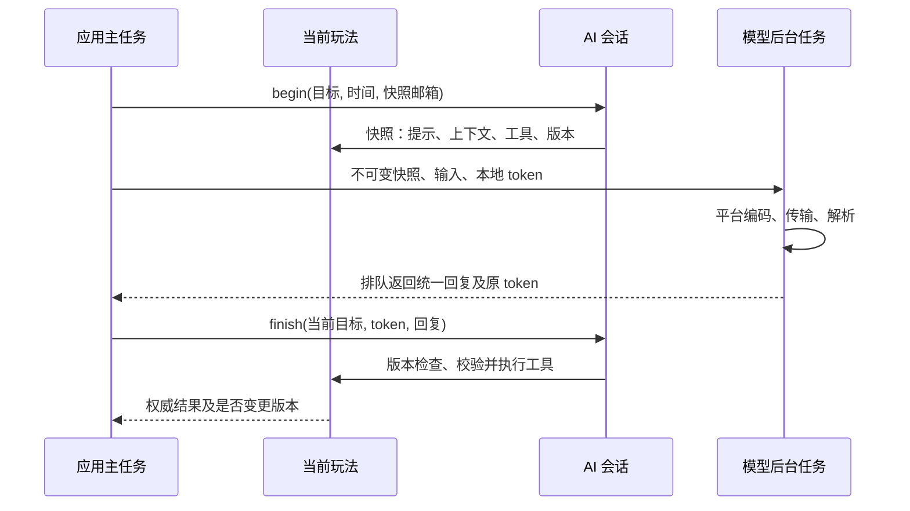

<p align="right"><strong>简体中文</strong> · <a href="billiards-scorekeeper.md">English</a></p>

# 台球记分器

本分支用独立的 320 x 240 横屏玩法大厅替换硬件测试入口，中八作为首个可用模块。
原演示源码保留作参考，但不链接进本应用。8 MB 分区布局未变。
追分、斯诺克、联网及 AI 语音属于后续迭代，本阶段尚未实现。

## 使用及交互约定

固定选手 A／B，记录胜局、判断胜负，支持最近 32 笔操作撤销。
这是比赛局数记分器，不跟踪逐球或充当裁判。姓名、球组、轮次及让局尚未实现。

| 页面 | 左／中／右短按 | 左／中／右长按 |
| --- | --- | --- |
| 记分牌 | A +1／设置／B +1 | A -1／未分配／B -1 |
| 设置 | 上一项／执行所选项／下一项 | 未分配／返回／未分配 |
| 抢几设置 | 减少／继续／增加 | 未分配／返回／未分配 |
| 新比赛确认 | 取消／确认／返回 | 未分配／返回／未分配 |
| 全局方向 | 选择 270°／确认／选择 90° | 未分配／取消／未分配 |

主页记分直接生效，无需选择或确认。零分不能再减；获胜后禁止加分，但仍可减分
纠正误记的获胜比分并恢复记分。玩法设置仅包含新比赛和撤销。新比赛清零需确认，
清零操作本身也能撤销。比分和撤销记录在重启后保留。

子页面统一使用中键短按执行／确认、中键长按返回。方向选择经中键确认才应用。
后续模块必须保持这些语义，不能把确认移到其他键。双击是独立的未分配事件，
不当成短按；长按不连发。BSP 短按窗口 180 ms、长按阈值 500 ms；直接记分仍需
等待手势分类。

默认 270°，设置也提供 90°，重启恢复最后确认的方向，不提供竖屏。
提示跟随实体按键边缘：270° 在顶部，90° 在底部。BSP 上／下／确定编号在 270°
映射为视觉左／中／右，90° 时反转；全部手势使用共享转换。用户已确认实体映射。
独立硬件电源键不作为软件输入提供，现有接线／BSP 不支持将其用于显隐提示。

默认闲置 30 秒调暗、120 秒关闭背光，应用设置可修改或关闭这两个计时；唤醒的完整手势被吞掉后才继续记分。
这里只节省背光功耗，不是系统休眠，也不代表已测得续航。

## 独立动作注册与界面外壳

`main/ui/app_actions.h` 是无动态分配的纯 C 注册模块。页面注册动作 ID、文字、
可用状态、语义、视觉位置及手势。`app_actions_resolve` 从同一注册表分发，未注册
或禁用动作不执行，重复位置／手势注册会失败。文字必须在注册表使用期间有效。

```c
app_bindings_t bindings;
app_actions_clear(&bindings);
app_actions_register(&bindings, 0, APP_GESTURE_SHORT,
                     ACTION_PREVIOUS, "Previous", true, APP_ACTION_NAVIGATE);
app_actions_register(&bindings, 1, APP_GESTURE_SHORT,
                     ACTION_CONFIRM, "Confirm", true, APP_ACTION_CONFIRM);
uint16_t action = app_actions_resolve(&bindings, slot, gesture);
```

`app_shell` 独立于玩法绘制注册动作。每个有动作的手势组占 24 像素，按短／长／双
顺序排列，无动作的整组不占行。一／二／三行分别留下 216／192／168 像素内容高度。
符号为 `·`（短按）、`—`（长按）、`··`（双击）。空位显示 `--`，禁用项弱化。
中八用两行直接加减。模块只在 `shell.content` 内绘制并随高度布局，不散放按键
说明，也不使用未显示的手势。

全部玩法和手势共享背景语义：确认／增加为绿色，取消／减少为橙红色，返回为灰色，
导航／普通操作为蓝灰色。颜色旁仍保留文字与符号。模块注册语义，不自行指定页面颜色。

## 配置、架构与扩展

`score_config.h`／`.c` 管理玩法默认值与范围：中八为两人、默认抢十、范围一至三十五。
初始化、新比赛设置、交互边界、规则校验和范围显示统一读取配置。旧记录保留自身
目标和比分，默认值改变不迁移比赛；范围改变需评估存档兼容。

- `score.h`／`score.c`：纯 C 会话、语义命令、有界快照、规则注册表和版本化存档。
- `chinese_eight.c`：状态校验、记分与胜负规则；支持一局 +1／-1 调整及旧胜局命令，
  拒绝未支持操作。
- `score_controller.c`：页面及动作注册／分发。
- `score_ui.c`：挂载到容器共享外壳的玩法内容控件。
- `score_store.c`：兼容既有记录的 NVS 适配。
- `games/eight_module.c`：中八会话所有者、规则／交互适配、初始化、命令处理和保存重试。
- `app/app_container.c`、`app_registry.c`：模块注册、进出及路由。
- `app/app_ui.c`：共享外壳和单一内容树挂载。
- `main.c`：硬件／输入所有者、电量快照、全局背光策略和 LVGL 同步。

增加玩法时添加稳定规则描述符和配置，以及对应交互、界面及测试。有符号分数
不代表未来规则已经实现；逐球／轮次状态可能需要明确扩展存档结构。BSP 可复用
硬件逻辑与应用状态、界面分开。

未来语音需在录音开始时绑定选手与会话版本，校验并去重结果，再向同一会话所有者
投递语义命令。`score_dispatch` 拒绝过期版本与无效操作，不调用 AI、网络、NVS 或
LVGL。传输、认证、超时和请求标识仍需实现。

## 持久化及失败行为

记分变化写 `billiards/session`，使用固定宽度小端字段、版本、CRC32 和撤销历史。
旧版方向使用独立带版本的 `billiards/ui`，新版全局设置存储见后文，不进入记分撤销历史。切换焦点不写 Flash。
NVS 提交位于 LVGL 锁外；失败保留待保存状态，每五秒重试并提示。未提交的修改
可能因掉电丢失。

NVS 初始化失败不擦除。异常比分记录保留到用户确认新比赛后才允许替换本应用记录。
设置缺失／无效时回退默认值；无效记录在用户确认设置前不替换。不清除其他命名空间。

## 字体及验证

固定文本清单位于 `score_strings.h` 和 `ui/app_strings.h`。
[字体来源与重新生成](../../assets/README.zh_CN.md#scoreboard-font)记录获许可的
16 px 子集。启动逐字检查实际控件字体并拒绝占位符；不支持任意姓名或 ASR 输出。

正常门禁覆盖容器导航与生命周期、占位隔离、模块重入和退出后保存重试，以及规则、边界、获胜纠错、撤销、过期命令、配置、旧存档恢复、损坏记录、
NVS 故障、唤醒顺序、实体输入转换、语义连续性及横屏 BSP 遮罩。

实际 LVGL 主机预览（需要 LVGL 9.5.0 源码）：

```bash
cmake -S tests/score_preview -B build/score-render -DSCORE_LVGL_SOURCE=/absolute/path/to/lvgl-9.5.0
cmake --build build/score-render -j 8
(cd build/score-render && ./preview)
```

导出两个方向下的玩法页面、大厅、占位页和九动作预览，并执行一次进入／记分／退出
路径。依据用户要求，默认不再跑重复压力循环。使用设备相同的 32 KB LVGL 池，
当前关键画面预览观察峰值 26048 字节。主机渲染不能证明实体位置、
屏幕观感、时序或功耗。

## 已验收阶段检查点

2026-10-29：用户认可当前交互和界面，并要求本地阶段提交；未要求推送或发布。

- Build: PASS，ESP-IDF 5.5.3 完整门禁。
- Host tests: PASS，含 500 次稳定 LVGL 渲染。
- Device tests: PASS，应用写入哈希校验和 18 秒启动观察；用户认可改版后的界面与操作。
- Unverified: 全页面／字形穷举、掉电／重启持久性、全部调暗灭屏唤醒情形、长期内存／
  栈余量及实测功耗续航。

验证过的本地归档：
`build/firmware/4c88c60ecf91f1057b88d72d8a0016e0c08c15127b5f5d6e50c6c51040454ea2/`。

- 合并镜像 SHA-256：`4c88c60ecf91f1057b88d72d8a0016e0c08c15127b5f5d6e50c6c51040454ea2`
- 匹配 ELF SHA-256：`ab11160a7ccebdd9d1a8c5b6360c6d5091662f800c288659045bff8969a9e612`

依据用户构建通过后自动烧录的持续授权，仅向 `0x10000` 写入匹配的 835920 字节应用，
保留兼容分区表和 NVS。启动到达 Ready，空闲堆 215092 字节、最大块 114688 字节，
未观察到 panic／assert／循环复位，串口已关闭。固件、调试归档及原始日志均保留本地
并忽略。从 `0x0` 写合并镜像可能重置 NVS；保留状态需兼容的分段更新，而非整片擦除。
本检查点提交不重新构建或烧录已验收固件。

## 玩法容器迭代

启动固定进入玩法大厅，左上一项、中进入、右下一项。选择中八后继续已有比赛。
追分、斯诺克、应用设置、AI／语音为明确的界面占位，可进入返回，不修改数据、
不配网、不启动服务。中八主页中键长按回大厅；子页面原有中键长按返回仍保留，
需先回记分主页再退出。回大厅后重新进入保留比分、历史及待保存状态。

`app_module.h` 定义模块描述（稳定 ID／标题／说明／类型／上下文）及回调：可选
启动初始化、进入、退出、动作注册、输入、可选 tick、界面创建和渲染。
`app_registry.c` 是唯一模块列表，`games/eight_module.c` 提供真实中八描述。
新增玩法实现回调并将描述加入列表，不需要改 `main.c` 或大厅渲染。ops 为空明确表示
占位项。65000 及以上动作 ID 保留给容器。

所有者回调位于 LVGL 锁外，不得访问控件；界面创建／渲染位于锁内。退出必须先停止
全部界面生产者并返回 true，容器才删除内容；退出失败保持玩法可见。只有一个挂载
内容树和一个外壳。玩法未显示时仍调用 tick，让保存失败持续重试。初始化只加载一次
旧中八 NVS，不渲染、不新开比赛。菜单浏览和占位操作不写比赛数据。

容器持有当前方向、导航和应用级入口。最初版本由中八用返回效果通知方向变更，
既有方向 blob／命名空间未改。最初占位的应用设置现已实现，方向已迁入后文的全局设置模块。
AI／语音条目与服务类型只建立导航位置，不代表已经实现 ASR／网络服务接口或功能。
最小容器完成后再逐步迁移全局设置和服务。

主机检查覆盖重复注册、进出失败、子页面返回与回大厅的区别、占位隔离、非活动 tick、
中八重入和旧目标存档恢复。实际 LVGL 预览将真实适配模块挂载／卸载一次，覆盖
进入／记分／退出及关键页面，不跑重复压力循环。本次迭代不包含新提交或推送。

2026-10-29 验证：

- Build: PASS，ESP-IDF 5.5.3 完整门禁及调试归档校验。
- Host tests: PASS，含容器／适配模块逻辑及关键界面预览。
- Device tests: PASS，仅限应用写入哈希校验及 18 秒启动观察；实体交互与观感待用户检查。
- Unverified: 实机大厅导航、进入／返回、比分保留及两个屏幕方向。

验证过的本地归档：
`build/firmware/7d9c7717ca4d6c05493e47eb9329f27df1d15fe151da3f4bf19b4bd35b5f8c3f/`。

- 合并镜像 SHA-256：`7d9c7717ca4d6c05493e47eb9329f27df1d15fe151da3f4bf19b4bd35b5f8c3f`
- 匹配 ELF SHA-256：`ca0ebf3055aa3dee1f0ff13ea157c0a8538a235cf419190674d4c12353b34ef7`

分区表与已验收检查点一致。依据持续烧录授权，仅向 `0x10000` 写入校验过的
844000 字节应用，未覆盖 NVS。启动到达 Ready，空闲堆 214868 字节、最大块
114688 字节。未观察到 panic／assert／循环复位，串口已关闭。

## 插画卡片轮播

大厅由列表改为横向卡片轮播。各注册条目通过不依赖 LVGL 的 `artwork` 元数据选择
配图。中间卡片完整显示图片与名称，两侧卡片缩小、变暗。上一项／下一项采用
220 毫秒缓动平移，配合图片与卡片缩放。原有三键提示、语义配色、循环切换及中键
进入保持不变。选择立即生效，动画过程中也能进入。快速反向切换重定位当前偏移，
不堆积动画。

`app_carousel` 管理五个复用卡片控件及一个有限时长 LVGL 动画，容器删除内容前先
取消动画；静止卡片没有持续动画。纯布局及循环方向放在 `app_carousel_layout`，
有针对性的主机检查。预览覆盖两个方向、中间帧、反向、循环及动画中退出，不跑
重复压力循环。

五张原创 176 x 96 RGB565 插画的像素共占 Flash 168960 字节，直接读取，不增加整图
解码器或帧缓冲。源生成器与 PNG 预览遵循素材目录流程。设备继续使用 32 KB LVGL 池。
主机预览仅验证布局与回调安全，动画流畅度和可读性需实机确认。

轮播验证，2026-10-29：

- Build: PASS，ESP-IDF 5.5.3 完整门禁；应用 1014656 字节。
- Host tests: PASS，针对性布局／路由测试及有限 LVGL 预览；观察池峰值 26048 字节，
  最终池空闲 7944 字节。
- Device tests: PASS，仅限写入哈希校验及 18 秒启动观察。
- Unverified: 实体屏幕动画帧率、观感及快速按键切换。

验证过的归档：
`build/firmware/d211c8dc88b47fcc2fe7284cbe8b783f60ab0a48159d2fb7617021a6c5dda874/`。
合并镜像 SHA-256：`d211c8dc88b47fcc2fe7284cbe8b783f60ab0a48159d2fb7617021a6c5dda874`。
匹配 ELF SHA-256：`b54fae49a6925968ad56d8a29226440cc2e705ebba79041e8c77bd3029c2d579`。
仅向 `0x10000` 写入已验证应用，分区表未改、未覆盖 NVS。启动到达 Ready，空闲堆
214772 字节、最大块 114688 字节，未观察到 panic／assert／循环复位。串口观察
已结束并关闭端口。本次未提交或推送。

2026-10-29：用户认可轮播观感与功能，并要求本地阶段提交；未要求推送或发布。


## 全局设置与共享滑轨

应用设置现已实现方向、亮度、自动调暗、自动灭屏和设备信息，中八内部仅保留新比赛与
撤销。方向经全局模块确认后通知容器，270°／90° 的按键映射与提示位置继续共用。
左右浏览设置，中键短按进入编辑／确认，中键长按取消编辑，浏览时长按回大厅。
设备信息显示固件版本及所有者每 30 秒更新的电量／电压快照，不代表校准了电量计。

共享 `ui/app_range` 控件在滑轨与滑块上方显示当前值，两端下方标出最小／最大值。
亮度为 20..100%，步长 10。调暗时间为 15／30／60／120 秒／无限制，灭屏时间为
60／120／300／600 秒／无限制。无限制在最右端，关闭对应计时。两端停住，不循环。
关闭调暗不影响灭屏，反之亦然；两个计时均到期时灭屏优先。亮度即时预览，取消恢复
已确认值。新比赛抢几同样使用共享滑轨及配置范围；仅页面显示时创建该控件，以适配
32 KB 池。

`app_preferences` 管理默认值、验证、编解码及闲置策略；`app_settings_model` 独立于
ESP-IDF／LVGL 管理按键编辑，真实设置模块负责持久化及界面。确认后的配置写入
`app_settings/config`：16 字节 AP／版本 1 blob，含方向编码、亮度、小端调暗／灭屏
秒数（零表示关闭）、保留字节与异或校验。没有新记录时读取旧 `billiards/ui` 方向，
配合默认亮度／时间迁移；不覆盖旧方向或比赛记录。记录损坏／读取失败使用默认值并
提示，仅明确确认才替换。保存失败每隔 5 秒重试，回大厅后仍执行；浏览和预览不写入。

主机检查覆盖编解码损坏、时间边界、调节边界、取消／确认、旧方向迁移和 NVS 读写／
提交失败。有限 LVGL 预览覆盖滑轨端点、无限制、两个方向、设备信息、方向确认传播及
取消，不进行压力循环。此阶段 Wi-Fi 配网仍延后，现已在下文实现；AI／语音和硬件休眠继续延后。


设置构建验证，2026-10-29：Build PASS（ESP-IDF 5.5.3 完整门禁）、Host tests PASS，
有限关键画面预览 PASS；LVGL 池峰值 25440 字节，最终池空闲 7800 字节。
已验证应用大小 1033904 字节。
归档：`build/firmware/6e5d6e239cef9b0d4f7039e179c37f02b4d01da71c3764cbf757aff4af9e595e/`。
合并镜像 SHA-256：`6e5d6e239cef9b0d4f7039e179c37f02b4d01da71c3764cbf757aff4af9e595e`。
匹配 ELF SHA-256：`b4dfbdfef855138d234651b5f59f6dd755e64b71307c3ebbf08945b61333790f`。
依据持续授权仅向 `0x10000` 写入已验证应用，保留兼容分区表及现有 NVS 内容。
实体滑块操作、亮度预览／取消、计时／唤醒和重启恢复待用户／设备验收，未提交或推送。

Device tests: PASS，仅限写入哈希校验和 18 秒启动观察。Ready 空闲堆 214516 字节，
最大块 114688 字节，未观察到 panic／assert／循环复位，串口已关闭。上述实体检查
仍未验证。

## 独立 QWERTY 输入测试

正式大厅已移除“输入测试”入口；独立实验室仅保留为主机预览测试夹具，不再编入固件。
可复用输入组件继续供 Wi-Fi 配置使用。之前的频率分组及选组界面已废弃。
本轮实现手机式 QWERTY 26 键布局，数字、符号使用独立键盘。9 键组字留待后续，
不会作为已实现选项显示。测试任务仍为 `there`、`1234567890`、`Ther_2026!` 和自由输入。
结果仅显示输入文字及目标是否一致，不显示统计。

| 手势 | 左键 | 中键 | 右键 |
| --- | --- | --- | --- |
| 短按 | 左移 | 输入／选择／确认 | 右移 |
| 长按 | 上一行 | 退格 | 下一行 |
| 双击 | 切换大小写（数字／符号下返回 ABC） | 编辑菜单 | 循环切换字母／数字／符号 |

键盘底行提供可见的 ABC／123／符号、空格、菜单、完成键，不熟悉快捷手势也可逐个
选取。纯数字模式隐藏非数字输入及键盘切换。各有效手势均注册到统一提示栏，保留
位置对应和语义颜色。左右移动在当前行循环，换行按相对列中心定位并循环。长按只
移动一次，不自动连移。光标页左右移动、中键返回、中键长按退格。编辑菜单提供
光标、显示／隐藏、确认清空、完成和确认退出；确认页继续中键确认、左取消、右返回。

`input/text_input` 为不分配内存、独立于 ESP-IDF／LVGL 的 ASCII 编辑器和键盘行数据。
配置支持最大长度（至多 64）、纯数字、密码遮挡、初始文本。测试页上限 63 字符、
明文显示。全部可打印 ASCII（含空格及大写）可达。密码模式仅显示最后插入字符一秒，
通过独立到期刷新遮挡，不依赖统计或后续按键。退出擦除文字，不存储、不传输。

`text_input_ui` 使用已校验的 14 px 中文／ASCII 字体、紧凑输入行与四行键盘。通过
单个 LVGL 绘制回调绘制虚拟键，避免每键独立控件的内存开销。界面在既有 LVGL 锁下
获取模型快照，绘制不会读取所有者线程正在修改的编辑器。键盘行布局可供以后扩展，
9 键选字及预测仍需单独实现，不宣称支持中文组字。实体按键回调仍只入队，没有
退出时需等待停止的界面工作线程或定时器。

主机检查覆盖 ASCII 清单、全键可达、行循环／映射、九个手势注册、底行操作、
大小写／键盘切换隔离、插入／退格／光标、遮挡、长度边界、确认清空／退出。
有限 LVGL 预览覆盖两种方向、大小写、各键盘、菜单、光标、清空、退出及结果。
不跑压力循环。用户已认可本版 QWERTY 方案；完整逐键验收和输入效率对比仍待实测。

验证，2026-10-29：Build PASS、Host tests PASS（完整门禁）。有限 LVGL 预览 PASS，
池峰值 25440 字节、最终空闲 10488 字节；应用 1072064 字节。
归档：`build/firmware/226e6024ffb6736cc17a6a0a5910b51db1713969c0d041b9d8c7bc9b8363918b/`。
合并镜像 SHA-256：`226e6024ffb6736cc17a6a0a5910b51db1713969c0d041b9d8c7bc9b8363918b`。
匹配 ELF SHA-256：`942c152f07802f42c227168509488589c7b8ac97a84de727a0c771c409015bd9`。
Device tests: PASS，仅限应用写入哈希及 12 秒匹配 ELF 启动，未见 panic／assert／
循环复位。设置／NVS 和分区表未覆盖，串口已关闭。
Unverified: 完整逐键操作、手势时序及实际输入效率；用户已认可本版效果。

## 热点配网与手机设置

进入“应用设置”，选择“网络连接”，进入网络页后按中键开启热点。
设备显示 `Billiards-xxxx` 开放热点名称（连接无需密码）和
`http://192.168.4.1/`。手机连接该热点，提示无法上网时继续保留连接。
DNS／HTTP 重定向协助系统弹出配置页；未自动打开时手动输入上述网址。
自动弹出取决于手机系统，不能保证。不需要蓝牙或小程序。
热点五分钟后关闭，也可在设备上主动关闭。

本地页面支持手动填写 2.4 GHz Wi-Fi 名称与密码，并使用与设备相同的档位
调整方向、亮度、自动调暗和熄屏时间。现已提供下文所述的附近网络选择列表。
修改通过现有设置模块应用、保存和失败重试。HTTP 提交成功仅代表收到请求，
不代表已经写入持久存储。网页显示连接状态、IP 和设备错误。
仅在成功连接并获取 DHCP 地址后才保存网络；错误密码不会覆盖原有记录。
最多延迟重试三次，间隔为 2／4／6 秒，每次连接等待上限为 20 秒。
最多保存 10 组 SSID／密码，按加入顺序循环覆盖；同名网络原位更新密码，
不重复占位或推进覆盖位置。仅当 10 个位置已满时，新网络才替换最早加入的一条。
保存失败不在内存中发布替换结果；开机和重连优先使用最近成功保存的网络。
设备和手机均提供已保存网络列表，选择后无需重新输入密码；接口不返回密码。
首次加载时导入旧版的单网络记录。确认清空全部网络后保存显式空列表，
避免旧记录重新出现。配置不变的重连不会重复写入。

`main/network` 将表单、凭据、DNS 和计时策略与 Wi-Fi 工作任务隔离。
按键只投递请求，Wi-Fi 事件只投递有界记录；网络及其 NVS 命名空间由服务任务管理。
HTTP 将显示修改交给应用所有者，不直接访问 LVGL 或设置存储。
管理请求仅允许目标地址为配置热点网卡的连接；API 还检查规范主机名，
写入需要每次热点会话的令牌。HTTP 页面在本地提供，配置热点开放且无线链路不加密；
NVS 凭据未进行静态加密。密码不写入日志。
本阶段不代表已验证互联网可达，也不实现云端 API、AI／语音传输或常驻局域网管理。
服务存活至应用结束，不持有界面指针；Wi-Fi 缓冲区和 HTTP 连接数有明确上限，
适应本设备无 PSRAM 的限制。

DNS／HTTP 引导参考 ESP-IDF 5.5.3
[热点配置示例](https://github.com/espressif/esp-idf/tree/v5.5.3/examples/protocols/http_server/captive_portal)。
网页与设备 UI 均为本应用独立实现。
主机检查覆盖严格解码、凭据长度、共享设置校验、畸形 DNS 包、重试次数和时间边界。
有限 LVGL 预览覆盖两种方向的离线、热点和忘记网络页面。
手机宽度浏览器预览使用模拟响应，不能作为真实无线测试证据。
手机自动弹页、正确／错误密码配网、重连、忘记、热点到期、远程设置持久化
和无线运行内存仍需实机验收。具体构建身份与设备观察结果记录在下方。

2026-10-29 验证：完整检查通过，Build PASS、Host tests PASS。
有限 LVGL 预览通过，内存池峰值 25440 字节，最终空闲 10464 字节。
390 像素宽浏览器预览确认没有横向溢出，并用模拟响应验证 Wi-Fi 提交、
90 度选择和无限制调暗提交。应用大小 1711552 字节。
归档：`build/firmware/17a3c5c6f7e3c16ecb57453319fa756cf3bd846a5f18517569597e864e8b77bf/`。
完整镜像 SHA-256：`17a3c5c6f7e3c16ecb57453319fa756cf3bd846a5f18517569597e864e8b77bf`。
匹配 ELF SHA-256：`0ca4ad14e6e903aa67cf220bbe58e7b3e95231b14bc4c38f6abee4d7607c19df`。
Device tests：仅应用写入哈希与 12 秒启动观察 PASS。
应用与网络服务均到达 Ready，空闲内存 120936 字节，最大连续块 110592 字节，
没有观察到 panic／assert／重启循环。
只写入 `0x10000` 应用区，未重写分区表和 NVS，串口已关闭。
上述手机与网络实机验收仍为 Unverified，未提交或推送。

2026-10-29 开放热点修正：配置热点使用 `WIFI_AUTH_OPEN`，不再生成密码，
手机加入时无需输入热点密码。屏幕明确显示“无需密码 · 直接连接”。
手机网页中的 Wi-Fi 密码字段用于有密码的家庭／上游网络，继续保留。
完整检查 Build PASS、Host tests PASS，有限 LVGL 预览与字形覆盖检查通过。
归档：`build/firmware/c7f34acf321dbe965ad25777531b9c767cf01c43a208033b8565ff565962999d/`。
完整镜像 SHA-256：`c7f34acf321dbe965ad25777531b9c767cf01c43a208033b8565ff565962999d`。
匹配 ELF SHA-256：`32afe03d033d4ab08bce792f444497ff02bf8e256433599f3fed287e7fb65b38`。
仅在 `0x10000` 写入 1711680 字节应用，保留 NVS 和分区表。
Device tests 仅写入校验和 12 秒启动观察 PASS：应用／网络均 Ready，
空闲内存 120784 字节、最大块 110592 字节，没有观察到 panic／assert／重启循环，
串口已关闭。手机加入和自动弹页仍为 Unverified，未提交或推送。

热点页面访问修正：开启 IPv6 配置时，ESP-IDF HTTP 服务使用双栈套接字，
lwIP 会将 IPv4 目标表示为映射的 IPv6 sockaddr。原先 IPv4 大小的地址缓冲区
截断了该结构，导致手机访问配置热点被错误返回 HTTP 403。
来源检查现改用 sockaddr_storage，识别 192.168.4.1 的 IPv4 和精确映射 IPv6
两种形式，继续拒绝其他局域网及原生 IPv6 地址。
有限主机回归检查覆盖两种有效形式、截断结构、非热点 IPv4／映射地址和原生 IPv6。
更新后仍需实机复验页面访问；此前浏览器模拟验收未覆盖此套接字路径。

套接字修复验证：完整检查 Build PASS、Host tests PASS。归档：
`build/firmware/f0efeb68a1c4f5d7f2aeaad3d758278288e0497aed54b0c9e616d3fca0a0279b/`。
完整镜像 SHA-256：`f0efeb68a1c4f5d7f2aeaad3d758278288e0497aed54b0c9e616d3fca0a0279b`。
匹配 ELF SHA-256：`8b80353a1e1ae81aba6676ea534a3733e2fb831e9044022c3c5e7adde211d12d`。
仅在 `0x10000` 烧录已校验的 1711840 字节应用，保留 NVS 和分区表。
Device tests 仅写入哈希及 12 秒启动观察 PASS，两项服务均 Ready，
未观察到 panic／assert／重启循环。串口已关闭。
手机实际 HTTP 访问仍为 Unverified，等待用户复验。

## 附近 Wi-Fi 选择

手机页面打开后自动请求一次异步扫描，并提供重新扫描按钮。
选择框列出信号最强的至多 16 个可见网络，显示信号强弱及开放／需密码提示。
同名且加密状态相同的网络合并，保留最强信号。选择后填入名称并清空旧密码，
隐藏网络仍可手动输入。网络名称以文本显示，JSON 编码转义特殊字符。
选择网络不会连接，仍需提交 Wi-Fi 表单。

扫描启动、完成、15 秒超时及驱动结果释放均由原有工作任务管理。
发起连接／重连或关闭热点时取消扫描并释放列表；连接期间拒绝扫描，
网页允许稍后重试或手动输入。GET `/api/networks` 返回有界缓存，
POST `/api/scan` 使用与其他写入相同的热点来源及会话校验。
不记录网络名称或密码。测试覆盖空／未终止名称、最强信号去重、排序、容量和 UTF-8 名称。
浏览器使用模拟扫描响应；实际发现网络与扫描期间热点连续性需单独实机验收。

2026-10-29 扫描增量验证：完整检查 Build PASS、Host tests PASS。
手机宽度浏览器使用模拟响应检查通过：网络列表、包含中文／引号／尖括号的名称选择、
名称填入、密码焦点、重新扫描和无横向溢出。
归档：`build/firmware/9fce16d6350d9e1a1ffb9627778093e42ea89b96a59fa1ea33a398a22a7a3442/`。
完整镜像 SHA-256：`9fce16d6350d9e1a1ffb9627778093e42ea89b96a59fa1ea33a398a22a7a3442`。
匹配 ELF SHA-256：`76bf2ab3033d337c0cab5d74f90576a73298f0a5c3d0154e6f701b11b15a3af5`。
仅在 `0x10000` 烧录 1742720 字节应用，保留 NVS 和分区表。
Device tests 仅写入校验与 12 秒启动观察 PASS：应用／网络 Ready，
空闲内存 120076 字节、最大块 110592 字节，未观察到 panic／assert／重启循环。
串口已关闭。真实无线列表、扫描与连接取消及手机热点连续性仍为 Unverified。
未提交或推送。用户已确认前一版套接字修复后手机可以显示设置页。

## 连接进度与结果反馈

手机 Wi-Fi 表单旁新增独立实时结果区，每秒更新一次，同一时刻最多一个状态请求，
请求超时五秒。提交后滚动到结果区，立即显示正在连接。
连接中显示次数（首次加至多三次重试）、剩余时间及获取 IP 阶段。
成功显示经过转义的网络名、IP 和保存结果；失败显示可操作的原因分类并允许重新提交。
认证失败提示检查密码和路由器设置，不直接断定密码错误。
热点切换信道导致手机短暂失联时，显示等待设备结果，不误报连接失败。
服务端用 JSON 转义网络名，单独返回网络保存错误。

设备网络页将连接状态作为主标题：中性色进度、绿色成功、橙色失败。
热点开启时也会显示 IP／保存结果或简短失败提示，同时保留热点名、网址和倒计时。
内容采用 14 像素应用字体，适配两种横屏。任意网络名继续在手机端显示，
因为设备的固定字库无法覆盖所有可能的名称。
连接过程中以及结果切换时重置空闲计时，避免屏幕自动熄灭。
获取 IP 表示连接路由器成功，不代表互联网或云端可达。

修正前的有限串口读取已观察到获取 IP 成功且无崩溃；旧版结果不醒目，
网页提交文案也没有转换为最终结果。这不代表新版端到端验收已完成。
有限预览现覆盖两种方向的连接中、获取 IP、成功、保存失败及认证失败页面。
主机检查覆盖原因分类，浏览器模拟响应检查实际提交后成功／失败的界面切换。

2026-10-29 反馈验证：完整检查 Build PASS、Host tests PASS。
有限 LVGL 预览峰值 25440 字节、最终空闲 10432 字节。
手机浏览器模拟确认实际表单提交后显示绿色成功、IP 和保存确认，
注入认证失败后给出原因并允许重试；390 像素布局没有横向溢出。
归档：`build/firmware/2fece9ef594bf8e5bb0d867d95e3e20736b6d268d4c32219d0eb1508eb317527/`。
完整镜像 SHA-256：`2fece9ef594bf8e5bb0d867d95e3e20736b6d268d4c32219d0eb1508eb317527`。
匹配 ELF SHA-256：`663797803abaf49b5d10e0bc0f51aa7390ce5783f1f80dc963827421b8e867fb`。
仅在 `0x10000` 烧录已校验的 1750112 字节应用，保留 NVS 和分区表。
Device tests 写入哈希、15 秒启动及保存网络自动重连获取 IP PASS，
约 3.1 秒获得地址。网络就绪时空闲 117884 字节、最大块 106496 字节，
连接后空闲 116964 字节。未观察到 panic／assert／重启循环，串口已关闭。
新版屏幕观感、手机真实热点轮询、错误密码恢复及真实保存故障仍为 Unverified。
未提交或推送。

## 共享标题栏与设备端 Wi-Fi 配置

大厅不再显示标题。统一的 `ui/app_header` 叠层负责左侧模块名、具有明显底色的
28 像素栏中央当前设置／页面名，以及右侧网络、电量状态。
大厅只保留状态标识并使用透明背景。游戏、设置、输入和占位页面共用标题栏，
模块只提供当前上下文，不再各自重复绘制电量和标题。
三条网络标识在连接时为绿色、连接中黄色、仅配置热点开启时蓝色、离线灰色，
失败增加橙色感叹号；表示连接状态，不代表实测信号强度。
网络快照变化时主任务刷新该栏。

屏幕方向同时列出“270 度／按键在上”和“90 度／按键在下”，高亮当前选项。
中键进入编辑，左右切换，中键确认，长按中键取消。
设备信息包括连接状态与 IP，网络设置摘要显示状态、当前 Wi-Fi 名及 IP。

进入网络连接后显示操作列表：选择 Wi-Fi、手机热点配置、重连、清空已保存网络和已保存网络。
左右浏览、中键进入／确认、长按中键返回；确认页保持左取消、中确认、右返回。
选择 Wi-Fi 在热点关闭时也可由工作任务扫描。
列表包含附近网络、手动输入名称和重新扫描。加密网络打开现有 QWERTY 密码组件，
默认遮挡；开放网络直接进入连接确认。手动 ASCII 名称输入先打开同一组件，
然后输入密码。扫描得到的 UTF-8 名称保留原字节，显示替代不影响实际连接。
密码使用与手机协议相同的校验；确认通过同一工作任务连接并在成功后保存。
取消、退出及成功提交清除临时密码。组件不记录输入，不另建 Wi-Fi 任务，
应用与 UI 回调保持非阻塞。

`network_setup` 是独立于 IDF／LVGL 的流程，有限主机检查覆盖扫描选择、
加密／开放路径、手动输入、无效凭据、取消、确认语义和清理。
其 UI 只挂载列表或键盘之一，适配原有 32 KB LVGL 内存池。
输入实验室仅保留在主机预览中，操作手势不变。`network_font_14` 为网络名增加驻留 Flash 的
2 bpp ASCII／CJK 覆盖；不支持字符显示为 `?`，不修改提交的 SSID。
来源、许可和生成方法见双语素材文档。
实际按键时序、可读性、新凭据连接及无线连续性仍需实机验收。

2026-10-29 共享标题栏／设备配网验证：完整检查 Build PASS、Host tests PASS。
有限真实 LVGL 预览覆盖大厅、全部设置、网络菜单／列表／键盘、开放网络确认、
忘记网络及两种方向；内存池峰值 24728 字节、最终空闲 10928 字节。
测试适配器使用模拟网络，没有压力循环。
归档：`build/firmware/aed9dec557106934696da79f240f11d8ea774e451ed02cdacde6dc1009a83ff5/`。
完整镜像 SHA-256：`aed9dec557106934696da79f240f11d8ea774e451ed02cdacde6dc1009a83ff5`。
匹配 ELF SHA-256：`f0ae8886efc07996edbf3a82efe9bf88b5d3087c063dc06925bf11374ef7703a`。
仅在 `0x10000` 烧录已校验的 2927600 字节应用，保留 NVS 和分区表。
Device tests 写入哈希、15 秒启动及约 3.3 秒保存网络重连获取 IP PASS。
网络就绪空闲 116348 字节、最大块 106496 字节；连接后空闲 115404 字节、
最大块 102400 字节。未观察到 panic／assert／重启循环，串口已关闭。
标题／网络名实机可读性、设备扫描／密码／确认、实际取消和新网络连接，
以及手机配网并行使用仍为 Unverified。未提交或推送。

2026-10-29 网络概览布局修正：状态、Wi-Fi 名称、IP 改成独立三行，
替换导致名称和 IP 重叠的空行定位。网络名使用常规文字色，长名称单行尾部省略。
有限 LVGL 预览覆盖离线、已连接、32 字节名称、设备信息往返和两种实际方向；
内存池峰值 24728 字节。完整检查 Build PASS、Host tests PASS。
已验证归档：`build/firmware/f4b953422b1c1be6aecbc490f5e1528f69927686fd78809803a4414c7303a8f8/`。
完整镜像 SHA-256：`f4b953422b1c1be6aecbc490f5e1528f69927686fd78809803a4414c7303a8f8`。
匹配 ELF SHA-256：`b999c108c05ee26d46d597ff4a53fd99de832c3d3842d7dbe115f1b493c01a78`。
Device tests 在 `0x10000` 仅烧录应用并校验哈希、15 秒启动及约 3.4 秒保存网络重连
获取 IP PASS；保留 NVS 和分区表，串口已关闭。未观察到 panic／assert／重启循环。
实机画面可读性仍为 Unverified。未提交或推送。

2026-10-29 移除输入入口验证：完整检查 Build PASS、Host tests PASS。
有限 LVGL 预览断言正式入口为五项且不含实验室，Wi-Fi 输入键盘保留。
Device tests 仅应用烧录／哈希校验、12 秒启动和保存网络重连 PASS，保留 NVS。
归档／完整镜像 SHA-256：`build/firmware/3d1e361f386dd3a1baafb2207b1b5528d043c385189f710458c59ed48a69c2e8/`。
匹配 ELF SHA-256：`f6bfefb62c7d3c575eb09a0defdc13ac543279a5818888a71d51fe5d7e568758`。
Unverified：实机大厅切换。串口已关闭；未提交或推送。

## 独立离线语音最小验证

“AI / 语音”入口现打开专门的试听页。左键短按切换三条测试短句，中键短按请求
播放，右键短按停止，中键长按回大厅并取消播放。开机和进入页面不自动发声。
本次验证音量固定为 65%。记分玩法暂未提交播报事件。

`main/speech/app_speech` 为独立于页面和 LVGL 的应用生命周期服务。
`app_speech_say()` 接收有界 UTF-8 文本并非阻塞复制请求。
连续待播请求按 650 毫秒安静窗口合并；正在播放的一句结束后，仅播放最新待播句，
不会形成无限队列。停止会清空待播并在 PCM 块边界取消当前播放。
启动后只有后台任务拥有合成、音频格式和播放操作，不访问 UI 对象。
快照报告等待、播放、完成、停止和错误状态。离开页面取消工作，不释放服务拥有的
数据。本次未接入识别或云服务，后续玩法可调用相同接口。

`main/speech/speech_model` 无平台依赖，测试覆盖合并时序、仅保留最新、取消、
UTF-8 有效性和 120 字节文本边界。后台任务使用 8 KB 栈，16 kHz／16 位单声道
流式合成，每次最多写入 320 个采样，设置保守的堆内存准入条件，并按次延迟创建、
清理 TTS。播放后恢复 codec 休眠。启用 I2S IRAM-safe 中断，但不据此认定可抵御
并发 Flash／NVS 写入卡顿。固定版本官方 C3 TTS 子集及许可见
[组件来源](../../components/esp_tts/README.zh_CN.md)。2913777 字节小新精简音库
映射在 factory 应用的 Flash 中，原有 NVS、PHY 和应用分区布局不变。
实际发声、音质、停止延迟、合成期间内存及网络并发仍需实机验收。
构建和预览成功不代表这些结果已通过。

2026-10-29 离线语音验证：完整检查 Build PASS、Host tests PASS。
有限真实 LVGL 预览使用模拟音频适配器覆盖两个方向、请求、播放、停止、错误和退出，
内存池峰值 24728 字节。归档／完整镜像 SHA-256：
`build/firmware/3b7de608bb27b093810462eac25ea53a36d274f2bbbe589cf53ff3fcce93f1ba/`。
匹配 ELF SHA-256：`78e517455f4306400e5795246785fc2bab5279059e009f45e414852c29602362`。
在 `0x10000` 烧录 5941840 字节应用，分区表未变，保留 NVS。
Device tests 写入／哈希、15 秒启动和约 3.7 秒保存网络重连 PASS，
未见 panic／assert／重启循环。联网后空闲堆 99348 字节，最大块 90112 字节。
串口已关闭。本次启动检查未触发 TTS 请求：实际合成、峰值内存、栈余量、发声和
实机停止／合并仍为 Unverified，由用户在“AI / 语音”页面触发验收。未提交或推送。

2026-10-29 语音唤醒修正：用户播放返回十进制 259（`ESP_ERR_INVALID_STATE`）。
启动和播放结束均会休眠 codec，在休眠状态调用 `bsp_audio_set_format()` 会被拒绝。
语音后台任务现先幂等初始化，再调用 `bsp_audio_wake()`，最后设置格式。
有状态 codec 回归使用旧播放代码复现失败；修复后首次播放、休眠后重播、
唤醒失败传播及恢复均通过。该主机检查不代表真实 TTS 输出已验证。

唤醒修复完整检查：Build PASS、Host tests PASS。已验证归档／完整镜像 SHA-256：
`build/firmware/99a0876703ba35c1709b010c93fc6f595b84fed612d9420c5bae3f6389795195/`。
匹配 ELF SHA-256：`dafc100aa7c60b705c831fc6408bb79b9ef54ac80c257b371ede53ced485c9f1`。
Device tests NOT RUN：当前目标 USB 串口不可用，尚未写入固件。
Unverified：实机 TTS 播放与重播。

2026-10-29 唤醒修复实机交接：用户重新连接设备后，将上述 `99a087...` 归档
中已验证的 5942192 字节应用烧录至 `0x10000` 并校验哈希，保留 NVS 和分区。
Device tests 写入／哈希、匹配 ELF `dafc100aa...`、15 秒启动和约 3.7 秒
保存网络重连 PASS，未见 panic／assert／重启循环。联网后空闲堆 99384 字节，
最大块 90112 字节，串口已关闭。实际播放／重播仍为 Unverified，等待用户触发试听。

## 统一模型配置

AI / 语音首页直接列出热点配置、已保存的具名模型及离线试听，没有模型时也能开启
热点。最多保存 4 个模型，左右滚动选择、中键进入、长按中键逐级返回；模型详情
右键启用当前条目。不提供平台预设、账户链接、平台占位或独立 ASR 凭据；模型配置仍然
独立于应用通用设置。

手机表单选择已有条目或空位，填写自定义名称（最多 12 个支持字符／36 字节 UTF-8）、
服务商提供的 Model ID（最多 96 字节可打印 ASCII）、完整 API URL
（最多 256 字节）和 API Key（最多 256 字节）。模型标识允许斜杠和冒号。URL 必须
包含完整请求路径；支持 HTTP(S)，不支持重定向、查询参数和 URL 内嵌凭据。
HTTPS 使用 ESP-IDF 根证书包；HTTP 会明文传输 Key 和音频。保存后启用该模型，
Key 留空仅保留当前条目的已有 Key；删除模型清空该条目，若正在启用则停止启用，
其他条目不受影响。名称使用现有网络字库，支持 ASCII、U+4E00–U+9FEF 汉字及
常用中日韩标点，拒绝表情及其他不支持文字。每个条目独立保存 Key。
快照、设备界面和 HTTP 响应均不回显 Key。

AI / 语音首页可直接选择热点配置；设备模型页左键也可进入手机配置，中键开始检测，右键启用已保存但未启用的配置。
第一个二维码连接临时免密热点，中键切换到 `http://192.168.4.1/#ai`。
设备和手机显示同一份已保存的模型标识、完整 URL（设备滚动显示）、检测阶段和
错误说明。手机轮询保留未保存输入；其他客户端修改配置后，必须主动重新读取。

`main/ai/ai_config` 负责表单校验及纯逻辑的保存／启用／删除；`ai_config_store`
通过网络任务串行处理一个有界请求，按键和 LVGL 回调不执行存储。
新记录为 `ai_voice/profiles`：`AI`、版本 1、启用字节，以及四组 37／257／97／257
字节的名称／Key／模型标识／URL 数组。网络任务仅在读写时分配有界序列化缓冲，完成后清零并释放；语音及检测只读取
小型运行快照，避免持有完整配置列表。手机显式选择条目，双端显示同一份名称、字段、当前选择及分条目检测结果。旧模型记录直接忽略，不提供迁移或兼容分支。
用户需要重新填写 AI 配置，Wi-Fi、比赛数据及选手名字不受影响。
写入／提交失败保留原生效配置，手机等待持久化完成才显示成功。

### 协议与能力检测

统一适配器使用非流式 Chat Completions 和 bearer 授权，请求地址由用户填写，
不添加平台专用参数。语音控制还要求同一请求支持 Base64 WAV `input_audio` 及
函数工具调用。仅支持文本、其他音频封装或仅支持 Realtime API 的模型不能直接接入。

手机保存后自动请求检测，手机及设备也可手动重测。`ai_probe` 依次进行三项隔离
检测：返回指定文本、带指定参数调用工具、听取固定合成语音并通过工具报告结果。
每项通过后记录结果，失败即停止并保留先前通过项及错误原因。总预算 60 秒，
与玩法录音共用串行语音任务，避免并行占用资源；不访问真实玩法执行器，不上传
麦克风录音，也不修改比分。最多发送三次少量 API 请求，可能产生服务费用。
通过只代表本次样例成功，不保证所有语句的理解或所有模型的兼容性。

修改／删除条目使该条目的检测结果失效；切换当前模型保留已完成的检测结果。
全局 generation 使配置变化时的在途玩法／检测请求失效，同时只运行一个检测。
普通状态轮询不影响玩法会话。检测结果仅保存在 RAM，重启后恢复未检测。双端统一显示排队、文本／工具／
音频检测、通过、失败及配置过期状态，包含授权、地址／模型、限流、网络、内存、
超时及非法回复的原因。

主机检查覆盖表单、持久化与重启失败、检测失效、通用协议编码、共享传输，以及
检测成功／分阶段失败／错误音频结果。浏览器使用模拟 HTTP，LVGL 预览覆盖两种横屏。
真实热点保存、板上堆栈峰值、真实模型兼容性及音频理解仍需使用用户配置进行实机验收。

验证，2026-10-30：完整门禁 Build PASS、Host tests PASS；语音／检测专项测试
同时通过 AddressSanitizer 和 UndefinedBehaviorSanitizer。浏览器在桌面及 390 像素
视口使用模拟 API，检查了保存／自动检测、含斜杠／冒号的模型标识、非法 URL 拒绝、
草稿保留及重新读取确认。两种横屏 LVGL 预览通过，32 KB 内存池峰值 24792 字节。
验证归档／完整镜像 SHA-256：
`build/firmware/51df873d40bf4ca6913b3e3ab8bff683479e834ddb6464796abfe4f5fd3710ad/`。
匹配 ELF SHA-256：
`9ec0584c75da4213b9e578ce70f8e350c340898e12199ec9bb1ec5c900f919cd`。
已连接 ESP32-C3 的分区表匹配，分段写入引导程序／分区表／应用及哈希校验通过，
保留 NVS 区域。15 秒串口窗口未捕获到数据，启动状态仍未验证。Device tests PASS
仅限写入及哈希校验；屏幕／按键、真实热点保存与重启、真实模型调用及堆栈峰值待验收。

具名多模型验证，2026-10-30：完整门禁 Build PASS／Host tests PASS；语音及检测
专项 ASan／UBSan 通过。测试覆盖独立 Key、重启、切换／删除、在途检测失效以及
语音路由到非零条目。模拟 API 浏览器检查覆盖两个具名模型、自动检测、启用切换、
删除隔离及 390 像素布局。真实 LVGL 预览覆盖首页热点入口、多模型列表及第二个
模型启用，两种横屏峰值均为 24792 字节。真实热点配置、持久化、模型调用、音频
及板上内存峰值仍待验收。
验证归档／完整镜像 SHA-256：`build/firmware/ccc5bbe3f33d2a8f567501c0d0c1e7b87c82971f54bb5e415e17070dcbcfc377/`。
匹配 ELF SHA-256：`4dc0e7542f250909b8aedebb7193e3a9d90bfcf832819e8c113fa6507f3d1ac0`。

已核对设备分区表匹配，分段烧录及 Flash 哈希校验通过，保留 NVS。12 秒启动
观察未捕获串口数据；启动、画面、实体按键及真实模型检测仍未验收。

具名模型页按网络字库实际 27 像素行高布局，单行状态区高 28 像素，模型条目扣除
内边距后至少保留 27 像素文字空间。循环滚动标签若内容区低于行高，即使文字横向
放得下，也会触发 LVGL 纵向滚动。真实 LVGL 定时回归检查等待一秒并刷新界面，
确认闲置列表像素不变，随后验证切换、进入和返回，覆盖两种横屏；静态截图不足以
验证动画行为。

纵向滚动修复验证，2026-10-30：修改前的真实 LVGL 检查复现了 20 像素内容区低于
27 像素字库行高。修复后两种横屏均通过闲置帧一致性及输入导航检查，完整门禁
Build／Host tests PASS。验证归档／完整镜像 SHA-256：
`build/firmware/1b8fef2aea14ee15e4845f8b0067122d83ca9d0dd09a31f0fb9da899aca133d3/`。
匹配 ELF SHA-256：`23c4bb00312e4160afe7ba7d3614f73008ef9b4c1ed650f367aaff019c7496a4`。
板上画面及实体按键仍需用户验收。

## 手机端按玩法配置

现有热点页面增加独立的“玩法配置”区域，通过下拉框选择玩法。中八提供左右两位
选手名字；追分、斯诺克明确显示待开放占位，不能提交配置。
默认仍为选手 A／B。两个名字作为一个版本 1 记录原子保存（`GP`、版本字节、保留
字节、两个 25 字节 UTF-8 名字），使用独立的 `game_prefs/eight` NVS 键。
比赛存档结构、比分、抢几和撤销历史均不改变，开始新比赛也保留名字。

`main/games/game_preferences` 将玩法描述、校验、表单解析与 ESP-IDF 存储适配分开。
稳定的选手位置仍是身份标识，名字用于显示和未来的语音别名。名字长度为 1–8 字符，
两人不能同名（ASCII 字母不区分大小写），支持现有 `network_font_14` 覆盖的字符：
可打印 ASCII、汉字 U+4E00–U+9FEF、中日韩标点 U+3000–U+303F、全角标点
U+FF01–U+FF60。前后半角／全角空格去除，不支持的字符和非法 UTF-8 直接拒绝，
不隐藏或替换。无需增加字库。

`GET/POST /api/games` 沿用其他设置接口的热点专用授权。HTTP 任务仅提交一个有界
更新，由网络后台任务写入 NVS 并发布完成结果。页面等待持久化提交完成才提示成功；
轮询和失败保留输入，配置版本过期时要求重新读取。读取异常保留原存档并使用默认值，
直到用户主动保存替换。玩法拥有者读取快照后刷新界面，HTTP 不访问 LVGL 或比赛状态。
计分卡、加减分反馈、获胜提示均使用名字及现有 14 像素大字库；左右按键提示简化为
`+1/-1`，保持按键与选手位置一致。

验收包括有限次主机测试，覆盖名字、重复字段、过期／忙碌请求、NVS 重启恢复及写入／
提交／读取失败；两个方向的真实 LVGL 渲染；模拟 HTTP 接口上的浏览器操作。
真实热点保存与重启、板上画面仍需用户恢复设备测试后验收。按本轮要求暂不烧录。

验证，2026-10-29：完整门禁 Build PASS、Host tests PASS。浏览器在手机和桌面尺寸下，
使用模拟 HTTP 接口检查了保存反馈、占位、输入校验、断连／保存失败时保留输入，以及
配置版本过期后的重新读取。两个横屏方向的真实 LVGL 预览通过，32 KB 内存池峰值
使用 24792 字节。按要求 Device tests NOT RUN。
验证归档／完整镜像 SHA-256：
`build/firmware/266b69fe55864a72c2f688767f635100802251174c8ba8acf0e45e39db803920/`。
匹配 ELF SHA-256：`7cbb0794de6194f6590f256a629a60d1f3bfdd195e36ae04471a40b0ea3b8bd8`。


## 玩法与 AI 交互契约

应用通过玩法模块的可选 `ai_game_ops_t` 能力注册 AI 接口；设置、服务和占位模块不
提供此能力。容器只返回当前真实玩法的目标。成功进入／离开时 `activation` 变化，
因此旧回复不能作用于重新进入的同一个玩法。

接口分为三个独立职责：

| 层次 | 职责 | 扩展入口 |
| --- | --- | --- |
| 玩法适配器 | 规则提示、球局上下文副本、带 JSON Schema 的中立工具、参数校验及权威执行结果 | 在 `app_module_t.ai` 注册 `snapshot`、`stamp`、`execute` |
| 会话调度 | 单个待处理请求、本地 token、30 秒超时、玩法实例／比赛版本／配置版本绑定、回复仅消费一次 | `ai_session_begin`、`ai_session_finish`、`ai_session_cancel` |
| 模型适配器 | 请求编码、工具调用／文本／澄清回复解析 | 在 `ai_model_adapter` 注册 `ai_model_adapter_t` |

玩法不引用模型配置、平台协议或网络 API；模型适配器不引用记分核心或具体玩法。
共享契约仅包含有界上下文、提示、工具结构、调用、版本和结果。工具用
`{name, description, parameters}` 中立数组描述，由 Chat Completions 适配器添加 `type/function`
外层。公共保留工具 `ask_clarification({question})` 转换为澄清回复，不调用玩法执行器。



`begin/finish/cancel`、容器访问和玩法回调均只在现有应用主任务中执行，位于 LVGL 锁外。
后台任务不访问实时玩法或控件。调用方拥有快照邮箱，在后台任务完成前必须保持不可变；
超时／取消不代表可以复用仍被后台任务持有的内存。原始本地 token 跟随后台任务，不能
取自模型生成的参数。旧 token 或错误 token 不会消费新的待处理请求。传输失败或回复
解析失败时取消对应会话。后续调度器必须在导航／模型变化前取消待处理工作，通过队列
返回结果，并在 `changed` 成功后刷新界面；实例检查额外防止遗漏取消时的旧回复。

首个适配玩法为中八。上下文包含玩法／计分单位、抢几、稳定选手 ID、名字、A/B 别名、
左右位置、比分、获胜者、空的当前选手、可否撤销及撤销目标比分。规则提示区分胜局数
和球分，选手不明确时必须澄清。工具如下：

| 工具 | 参数 | 本地行为 |
| --- | --- | --- |
| `adjust_score` | `player_id`、`delta`（-1 或 +1）、`expected_revision` | 按稳定 ID 解析选手，派发现有记分命令 |
| `undo_last` | `expected_revision` | 使用现有有界撤销历史 |
| `get_score` | `expected_revision` | 读取权威比分，不保存、不改变版本 |
| `ask_clarification` | `question` | 返回文字，不改比赛 |

例如 `adjust_score({"player_id":"p1","delta":1,"expected_revision":7})`，仅在本地捕获的
请求仍有效时才可给左侧选手增加一局。请求版本和工具版本均需匹配；通配版本、多余／
重复参数、未知选手／工具、小数、负分和结束后加分均拒绝。AI 命令与按键共用模块的
`dispatch` 路径、界面反馈、延后保存和撤销历史。名字是标签；改名使正在等待的解释
失效，但不改变选手身份。首版不暴露新比赛／清空工具。进入手动设置子页时拒绝 AI
快照和执行。

Chat Completions 适配器编码单轮非流式文本或音频请求，解析为一条文本、澄清或工具结果。多候选／多工具、
截断、非法 JSON、重复键、内嵌 NUL、非法 UTF-8 和超长值均拒绝。工具附带文字会被
丢弃，避免声称操作已成功。普通模型文本与权威操作结果分开，不能改变玩法。凭据不在
请求体／快照中，由 HTTPS 传输模块复制到授权请求头。

最初的契约迭代提供玩法执行和 Chat Completions 协议编解码。下面的语音协调层现已将这些接口
连接到麦克风、直连 HTTPS 和玩法按键；仍不提供独立 ASR。

全部缓冲区有界，JSON 使用调用方持有的工作区解析，不进行堆分配。64 位主机测试中，
快照为 3600 字节、解析工作区 6168 字节、会话 56 字节、回复 688 字节、完成结果
396 字节；这些不是 ESP32 堆测量。后台任务必须使用静态或显式分配的大邮箱／
工作区，不能放在应用栈上。中八参数解析器仅供主任务使用，持有一个静态工作区。
文字请求封装／响应体各限 6144 字节，音频分块上传；文字输入最多 511 字节、参数最多 255 字节、输出文字
最多 384 字节，超长拒绝，不做截断。


初始契约验证，2026-10-30：完整门禁 Build PASS、Host tests PASS。集成测试使用真实容器、
中八模块、记分核心和 Chat Completions 编解码器，模拟模型回复，验证了加减分／撤销／查询及保存、
未知／重复／非法参数、规则拒绝、手动改分／改名竞争、离开后重进、取消、超时、重复
或错误 token、文本／澄清隔离、非法模型回复和有界 JSON 处理。同一集成测试通过
AddressSanitizer 和 UndefinedBehaviorSanitizer。有限次真实 LVGL 预览在两个横屏方向
通过（峰值 24792 字节）。Device tests NOT RUN；传输、真实模型理解、麦克风、板上
内存／时序和实体按键仍待验证。该迭代未烧录。
验证归档／完整镜像 SHA-256：
`build/firmware/3448c01938b1e542aa8bf2edce6693227e8d2882004df0397327088cc499ef77/`。
匹配 ELF SHA-256：`f5fc27269afe568582ca6ffdfc4e0b7da42b47c04065adf1c0dd1e907e7a7e11`。


## 中键语音控制

`main/ai/app_game_voice` 协调当前玩法、音频任务和模型适配器，不引用特定玩法的记分
类型。玩法继续自行验证和执行操作。不使用网关、独立 ASR 服务、唤醒词或持续监听。
先在现有 AI 语音手机配置页填写 API URL、Key 和支持音频的 Model ID，连接 Wi-Fi，再进入中八。

| 状态 | 中键短按 | 中键长按 | 中键双击 |
| --- | --- | --- | --- |
| 正常玩法 | 设置 | 返回大厅 | 开始录音 |
| 准备中 | 禁用 | 取消 | 禁用 |
| 录音中 | 发送 | 取消 | 禁用 |
| 上传／理解中 | 禁用 | 取消 | 禁用 |
| 取消中 | 禁用 | 继续取消 | 禁用 |

左右键保留原有手动记分手势，先取消语音会话，再交给玩法处理。取消立即阻止执行，
后台清理可能需要等待网络超时。清理完成且主任务消费结果之前，不复用缓冲区。
两个横屏方向均使用公共语义颜色动态注册提示行；录音状态和回复替换记分板下方反馈区。
手动导航清除语音反馈。普通模型文字不会修改比分；已接受工具显示并朗读玩法生成的
权威结果。文本和澄清回复也尝试本地 TTS，但受现有 120 字节限制；长回复仍在状态条
滚动显示。只有玩法激活标识、比分、选手姓名和模型配置均未变化，澄清才传到下一次
录音。这是单轮澄清，不是完整聊天历史。

应用级后台任务使用 12 KB 栈。录音从本地 TTS 获取独占租约，唤醒编解码器，以
16 kHz／16 位单声道采样，两点平均到 8 kHz，使用不超过 40000 字节临时 RAM 保存
IMA ADPCM。发送或达到 10 秒结束录音；静音和不足 250 ms 的片段拒绝上传。
上传逐步解码为普通 8 kHz／16 位单声道 WAV，以 768 字节分块进行 Base64 编码，
将通用 `input_audio` 与捕获的玩法上下文／工具一同发送。服务端不会收到 ADPCM。
录音不写入 NVS 或 Flash。堆分配、HTTP 错误、超长回复和非法工具失败均不改变比分。
文字封装头限 6144 字节、尾限 4096 字节，响应限 6144 字节。解析器在 TLS 前释放，
HTTP 清理后重新分配；录音在上传后释放。这些是分配预算，不是板上内存峰值测量。

Wi-Fi 获得 IP 后启动 SNTP。语音准备最多等待五秒取得合理时间，再进行证书验证的
HTTPS。连接超时五秒，之后每秒轮询 I/O，总受会话 30 秒期限约束，含准备和录音。
响应头／读取超时会继续等待，不会重复提交模型请求。DNS／驱动内部可能推迟清理，
UI 主任务保持非阻塞，迟到结果被丢弃。证书使用 ESP-IDF 常用根证书包。分区和 NVS
格式保持兼容；凭据只复制到后台任务和授权请求头。

验证使用真实协调层／后台任务和确定的音频／HTTP 边界，覆盖有限的编码质量／边界
检查、十秒自动发送、手动／模型竞争、已完成邮箱复用、取消、分配／编解码器／HTTP
失败、响应头／读取重试、音频 JSON、澄清和语音租约。专项后台测试通过 AddressSanitizer
和 UndefinedBehaviorSanitizer。真实 LVGL 预览覆盖 90／270 度录音、等待和错误状态，
LVGL 峰值 24792 字节。Device tests 仍为 NOT RUN：麦克风电平、8 kHz 音频理解、
真实 HTTPS／TLS 堆和栈峰值、取消时序、本地播报及实体双击均需板上验收。未烧录。


语音实现验证，2026-10-30：完整门禁 Build PASS、Host tests PASS；Device tests NOT RUN。
未烧录，也未修改设备 NVS。提示渲染可在主任务持有 LVGL 锁时读取玩法 stamp；该操作
仅复制玩法／配置状态，不进行 I/O。
验证归档／完整镜像 SHA-256：
`build/firmware/25dbd1889d0c1e3872ab1ed742fb3b2cf7860bcf3d7424937ed4f87a7b4a7b24/`。
匹配 ELF SHA-256：`751314bf7ab8218b3afcd88357e149571fd7494d4f12a96d9687f621c954a896`。

## 本地语音内存准入

设备播放失败 257（`ESP_ERR_NO_MEM`）已定位到合成前的内存检查：
空闲堆 51104 字节、最大连续块 43008 字节，低于原有 70000 字节总空闲要求。
此路径为本地 TTS，不请求模型。两个安全门槛均保持不变；能力检测工作区、
玩法语音任务快照、命令／结果 JSON 解析区及 HTTP 模型快照改为按需申请，
完成或失败后释放。取消语音任务仍等工作线程完成后才释放快照。
申请失败在比分分派前拒绝命令。主机检查覆盖内存不足拒绝、任务申请失败、
取消后的释放和能力检测申请失败。2026-10-30 分段烧录修正版并保留 NVS 后，
用户确认本地播放成功且有声音；模型／网络并发及运行内存峰值仍待验证。

## 语音上传分配生命周期

录音使用独立的 2048 字节块，上限仍为 40000 字节有效数据／10 秒
（分块实际占用最多 40960 字节），不再扩容连续录音缓冲。
请求编码仍使用有界 6144 字节头部和 4096 字节尾部工作区，编码结束后收缩到实际
长度再建立 TLS；纯文字请求不分配音频尾部。录音及尾部在上传完成后、读取响应前
释放；响应上限仍为 6144 字节。能力检测的工具参数解析区仅在校验返回时申请，
不再贯穿 TLS 生命周期。录音格式、证书校验、比分校验及取消行为均保持不变。

阶段日志记录 TLS 建连、响应头及结果解析时的空闲堆和最大连续块，失败记录阶段
及数字错误码，不记录 Key、录音、请求正文或模型回复。有限主机检查跟踪全部语音
自有分配，逐字节核对短录音及完整录音的 WAV 流，并确认成功、取消和失败后没有
残留分配；覆盖分块申请失败及封装工作区可选收缩失败。上述分配数值不包含真实音频／无线／TLS
内存，不代表板上实测峰值。

2026-10-30 验证：完整 Build／Host tests PASS，专项 ASan／UBSan 及有限 LVGL
预览通过。主机确定性 0.4 秒录音为 1600 字节，TLS 起始语音自有分配共 6253 字节；
10 秒样例分别为 40000／44653 字节，均不含板上 TLS 等库的分配。
验证归档为 `build/firmware/bda1cd866926d85813d4cda4063bba2830695b661c0dc5758e9521a60ec9bc3c/`，
匹配 ELF SHA-256：`5517950bb7d96a08c0751b27297793b3d261bd6b00fc7da8814b237b80a79c5e`。
分区对比、分段烧录与哈希校验通过，保留 NVS；实际 TLS 峰值与语音记分待设备验收。


### 分块录音与音频／网络资源所有权

2026-10-30 实机复现定位旧连续录音缓冲的 257：申请 32768 字节失败，
当时空闲 41412 字节、最大连续块 30720 字节，两次结果一致。
较短录音（11200 字节 ADPCM）完成证书验证、HTTPS 和回复解析，用户确认成功。
28674 表示 HTTP 连接失败；通用 -1 需要结合传输阶段，不能单凭该值认定内存不足。

录音改为追加独立的 2048 字节块，避免 realloc 搬迁和临时双份占用；上传成功后
逐块释放已消费的数据，10 秒录音上限仍为 40000 字节有效数据。
录音租约贯穿录音、音频资源释放及整个模型请求，避免本地 TTS 与 TLS 争抢内存。
后台专用 `bsp_audio_release()` 先验证编解码器休眠，再释放私有 codec、I2S／DMA，
保留共享 I2C 总线及音量；下次录音或 TTS 通过 init／格式设置重建音频。
轻休眠继续保留通道。休眠或通道释放失败会返回错误，不宣称释放成功。

有限主机检查限制单次分配不超过复现时的 30720 字节，逐字节验证跨块 WAV，
覆盖中途分块申请失败及 HTTP 建连／写入／读取失败，确认语音自有分配全部释放。
短／完整录音在 TLS 开始时的主机自有分配分别为 6701／45613 字节，包含分块
取整、不含实际 TLS／音频／无线分配。BSP 检查覆盖释放、幂等及保留音量的重建。
新增请求清理及任务结束日志观察堆恢复，不记录请求内容。
本版长录音、连续请求、恢复播报及 TLS 余量仍需实机验收。

完整 gate 的 Build／Host tests PASS，专项 ASan／UBSan PASS。验证镜像
SHA-256：`39e0d6c34dbd956b5b6c1893a9d397da7c7146238fbe4af78da19986c975002e`；
匹配 ELF：`ec3265ba2a9e099c2f2ef2cec6201388d2f4af2d69085b891fcec0c48f7d5e1d`。


### 简短反馈与可打断的原始语速播报

分块版本后续实机复测中，长／短请求（35440／12000 字节 ADPCM）均完成且有播报，
用户确认成功。清理后空闲堆分别恢复为 79648／79640 字节，最大块均为 61440 字节。
此前报告的 HTTP 错误 28674／-1 未捕获，也未在此次复测重现；这不等于长期网络
稳定性通过。长回复播报时，speech 任务在官方拉伸函数中触发 IDLE 任务看门狗警告，
之后播放完成。

中八提示要求一句简短回答（最多 30 个中文字或 20 个单词），澄清最多 20 个中文字
或 15 个单词，不加列表、寒暄或重复解释。比分执行继续使用本地权威比分短句。
这些属于模型提示，不能保证回复严格遵守字数。播报邮箱支持最多 384 字节 UTF-8，
对齐 AI 文字契约，超长输入拒绝而非静默截断。播放按标点或最多 12 个码点分段，
不切断 UTF-8，在音频块／分段间让出 CPU。调用官方 speed 0 原始语速，绕过固定版本
库中的拉伸计算，替代原来的 speed 3；保留 30 秒播放期限及取消版本检查。

玩法记分板上，播放中或待播时，中键短按动态显示“停止”，使用已有取消色。
按下取消当前和待播内容，不打开设置、不修改比分；中键长按返回、双击录音保留。
停止后恢复常规设置提示。本地试听页中键也在“播放／停止”间切换，保留右键停止。
取消在 PCM 边界处理；真实停止延迟及原始语速音质仍需听测。主机检查覆盖 UTF-8／
标点边界、完整分段顺序、原始语速选择、段间打断、待播取消及玩法动态按键提示。

完整 gate 的 Build／Host tests PASS，ASan／UBSan 播报检查 PASS，有限
90／270 度 LVGL 预览通过（内存池峰值 24792 字节）。实机原始语速音质、
中键停止延迟及是否仍有看门狗警告待验收。

`build/firmware/ce6881d7a267f344326ff507a14a809e233a350c9122817b077d26184eb9674c/`

ELF SHA-256: `416499b76b441b37fd8b2f4bca87585131d00e8b89092de043ca564608087ca5`.


### 上传拥塞等待

捕获到一次 HTTPS 证书验证成功后的上传 -1：TLS socket 的一秒可写轮询超时，
应用此前把未写入数据的零返回立即当作致命失败。现在 TLS 零字节轮询会继续等待，
最多允许十秒没有进展，并始终受取消和原有会话总期限约束。正返回按实际写入量
前进；负返回仍立即失败，不重新建连，也不重复提交模型请求。

每次 HTTP 写入限制为 512 字节，处于最小 TLS 片段内。固定的 ESP-IDF 5.5.3 同步
HTTP 写入循环在后续传输失败时可能丢失先前的部分写入量；TLS 单片段避免此循环，
因此零返回代表传输层在真正写入前轮询超时。普通 HTTP 的零返回不重试，因为 TCP
可能隐藏部分进展。不修改 SDK 文件或证书校验；一秒轮询保留取消响应能力，等待
期间让出 CPU，日志仅包含等待次数／结果。

专项主机故障注入覆盖上传前／中途零返回、部分正写入、JSON／Content-Length／WAV
字节一致性、十秒无进展、等待时取消及致命写入失败，确认语音缓冲无泄漏且不会
重复改分。真实慢网络恢复及实体取消仍需实机验收，与合成传输检查分开报告。

完整 gate 的 Build／Host tests PASS，专项 ASan／UBSan PASS；真实慢网络
设备验收仍待进行。

`build/firmware/9c17c5f3ef10674267bd54b230d24915e23e06abf6345993f0e7ad169591f0c2/`

ELF SHA-256: `59d3e3857a9403de1fb985e94e60bf1f6d84582a0f51ecc6ed5439e7a336cd93`.


### 有界的辅助推理响应

玩法响应读取器每次读取 512 字节，由适配器选择需要丢弃的辅助字符串字段
（兼容适配器使用 `reasoning_content`）。接收时将这些字符串值替换为空字符串，
为权威 JSON 解析器保留的内容最多 6144 字节。整包传输另外限制为 65536 字节，
并不分配 64 KB 缓冲。其他字段、工具参数和重复键仍交给校验；被丢弃的字符串
依然检查转义、UTF-8 和代理对。完整接收、解析、校验之前不执行任何指令，
超过任一上限均失败且不改变比分。

这减少保留的内存，不减少模型生成时间或传输字节，也不会关闭模型思考。
其他辅助格式不会被静默删除。诊断仅记录传输／保留字节数，不记录模型文本。
有限主机用例覆盖分片长推理、正常内容及工具参数、非法字符串、重复键、
精确输出容量、不启用过滤及传输上限，并包含实际玩法后台任务／HTTP 边界。

完整门禁 Build／Host tests PASS，专项过滤器及实际后台任务 ASan／UBSan PASS。
验证镜像为
`build/firmware/05667e72497625b4bf2912011c7ecaf63183d857e8078a97d76476af48891e7e/`，
匹配 ELF SHA-256 为
`81c46ab6ed9ff36b7a20a531e40e73b0ec30693ce7d6c02c081ad571c14dadff`。
修复前捕获的 260 出现在响应缓冲达到容量时；由于不记录正文，不能断言超长字段
就是推理。本版实际模型验收仍待完成。
